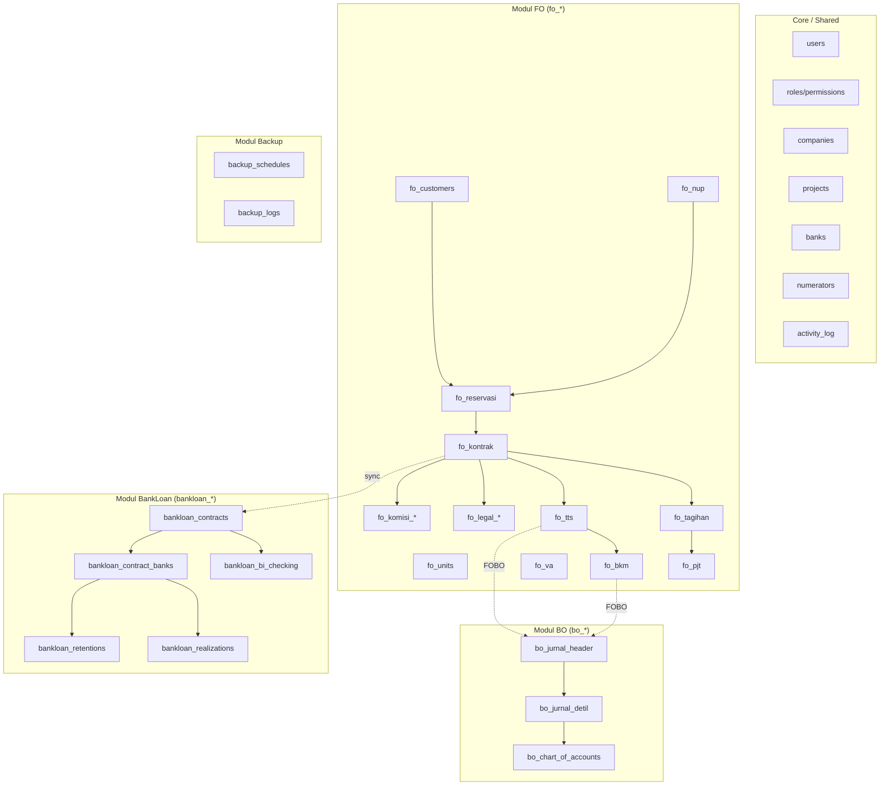
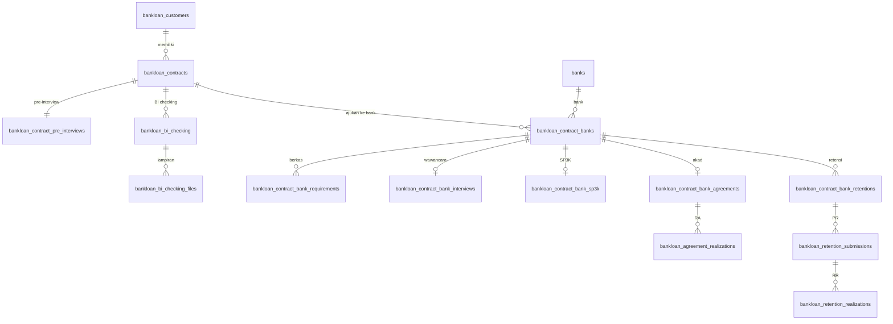
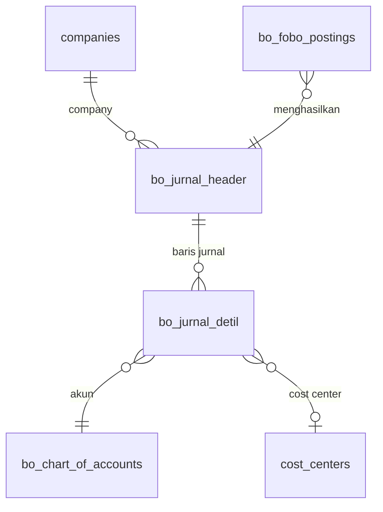

# ERD — Entity Relationship Document (Target MySQL 8 / Laravel 11)

**eProperty (Clone) — Database Model**
Companion: [00_README.md](00_README.md) · [01_BRD.md](01_BRD.md) · [02_PRD.md](02_PRD.md) · [04_BusinessFlow.md](04_BusinessFlow.md) · [05_NFR_dan_Kebutuhan_Teknis.md](05_NFR_dan_Kebutuhan_Teknis.md)

> Skema **target** untuk MySQL 8 + migrasi Laravel 11 (single DB, prefix tabel per modul). Diturunkan dari schema legacy KPR API (otoritatif, 103 migrasi EF Core) + skema FO/BO inferred. **FO/BO wajib diverifikasi** dengan restore `.bak` sebelum implementasi final.

---

## 1. Prinsip Desain

| Prinsip | Keputusan |
| --- | --- |
| Database | **Single DB** `eproperty` (MySQL 8, InnoDB, `utf8mb4_unicode_ci`) — bukan 17 DB seperti legacy |
| Pemisahan modul | **Prefix tabel per modul**: `fo_`, `bo_`, `bankloan_`, `backup_`, dan tabel core tanpa prefix khusus (`users`, `companies`, dll.) |
| Multi-tenant | Kolom `tenant_id` di tabel transaksi (siap SaaS; default 1 tenant). Global scope `TenantScope`. |
| Primary key | `id` BIGINT UNSIGNED AUTO_INCREMENT (surrogate). Natural key (no_kontrak, kode_unit) tetap unik & dipakai sebagai referensi sync. |
| Soft delete | `deleted_at` (trait `SoftDeletes`) di semua tabel transaksi |
| Audit | `created_at`, `updated_at`, `created_by`, `updated_by`, `deleted_by` (trait `Auditable`) |
| Status | Enum/string Indonesia (`BOOKING`, `CICILAN`, `LUNAS`, `BATAL`, dll.) — disimpan sebagai `VARCHAR`/`ENUM` + dokumentasi nilai |
| Uang | `DECIMAL(19,4)` |
| Tanggal | `DATE` / `DATETIME`; timestamp aplikasi `TIMESTAMP` |
| Charset | `utf8mb4` (mendukung nama & alamat lengkap) |

### 1.1 Referensi natural-key untuk sync

Banyak relasi lintas modul legacy memakai **kode string** (`kode_unit`, `no_kontrak`) bukan integer ID, agar bisa cross-DB. Di target single-DB, gunakan **FK surrogate (`*_id`) untuk join fisik**, tetapi simpan juga **kode natural** untuk payload event/sync & audit log (terbukti dari refactor `ChangeLogReferenceIdToCode` di KPR API).

---

## 2. Diagram Tingkat Tinggi (Klaster)



---

## 3. Tabel Core / Shared (tanpa prefix modul)

| Tabel | Kolom kunci | Catatan |
| --- | --- | --- |
| `tenants` | id, code, name, is_active | Untuk multi-tenant masa depan |
| `users` | id, username (uniq), email, password (bcrypt), full_name, profile_image_path, is_active, is_blocked, last_login_at, bad_login_count, tenant_id | SSO terpadu (gabungan user FO/BO/KPR) |
| `roles`, `permissions`, `role_has_permissions`, `model_has_roles`, `model_has_permissions` | standar Spatie Permission | permission `module.area.action` |
| `login_attempts` | id, user_id, attempt_at, is_success, ip_address | lock 3x/30 mnt |
| `password_histories` | id, user_id, password_hash, created_at | cegah reuse |
| `verification_codes` | id, user_id, code, purpose, expires_at, consumed_at | reset/konfirmasi email |
| `notifications` | id (uuid), user_id, type, title, body, reference_id, read_at | in-app (Laravel notifications) |
| `companies` | id, code, name, address, logo_path | multi-company |
| `projects` | id, code, name, address, profile_image_path | proyek properti |
| `banks` | id, name, branch, city, street_address, account_number, account_name, retention_scheme | master bank (KPR) |
| `cost_centers` | id, code, name, company_id | akuntansi |
| `numerators` | id, doc_type (KPR/RA/PR/RR/TTS/BKM/...), prefix, period_mode (year/month), padding, last_number, company_id, period_key | **atomic** (row-lock) |
| `settings` | id, group, key, value (json), tenant_id | konfigurasi global + feature flag |
| `activity_log` | id, log_name, description, subject_type, subject_id, causer_id, properties (json), created_at | Spatie Activitylog (audit) |
| `documents` | id, code (uniq), name, description, project_id | master kode dokumen (dari KPR `Document`) |
| `external_applications` | id, code, name, app_id, app_secret (encrypted), db_prefix_name, is_sync_active | partner sync (mis. Agenku) |
| `occupations`, `incomes` | id, name / range_label | master pekerjaan & penghasilan (KPR) |

---

## 4. Modul BankLoan (`bankloan_*`) — OTORITATIF

> Diturunkan langsung dari 103 migrasi EF Core KPR API. Port migrasi **berurutan & semantik identik**.

### 4.1 Daftar tabel

| Tabel | Kolom kunci | Relasi |
| --- | --- | --- |
| `bankloan_customers` | id, code, name, nik, birth_place, birth_date, email, phone_number, address, occupation_id, income_id | → occupations, incomes |
| `bankloan_contracts` | id, contract_number (KPR-...), booking_number (null), booking_date, customer_id, project_id, company_id, unit_code, sales_person_name, total_price, submission_amount, down_payment, active_status, buyback_status | → customers, projects, companies |
| `bankloan_contract_pre_interviews` | id, contract_id, fund_source (null), purchasing_purpose (null) | → contracts |
| `bankloan_bi_checking` | id, contract_id, result, checked_at, notes | → contracts |
| `bankloan_bi_checking_files` | id, bi_checking_id, file_path, original_file_name, uploaded_at | → bi_checking |
| `bankloan_contract_banks` | id, contract_id, bank_id, requirement_status (null), approved_amount, approved_description, status | → contracts, banks |
| `bankloan_contract_bank_requirements` | id, contract_bank_id, requirement_id, filing_date, file_path, original_file_name, status | → contract_banks, requirements |
| `bankloan_contract_bank_interviews` | id, contract_bank_id, interview_date, result, notes | → contract_banks |
| `bankloan_contract_bank_sp3k` | id, contract_bank_id, sp3k_number, sp3k_date, result (null), approved_amount | → contract_banks |
| `bankloan_contract_bank_agreements` | id, contract_bank_id, agreement_number, agreement_date, notary, disbursement_type | → contract_banks |
| `bankloan_contract_bank_retentions` | id, contract_bank_id, retention_category_id, amount_held, scheduled_release_date | → contract_banks, retention_categories |
| `bankloan_agreement_realizations` (RA) | id, number (RA-...), contract_bank_agreement_id, realization_date, disbursed_amount, excess_realization_amount, status | → contract_bank_agreements |
| `bankloan_retention_submissions` (PR) | id, number (PR-...), contract_bank_retention_id, submission_date, requested_amount, sales_person_name, contract_number, status | → contract_bank_retentions |
| `bankloan_retention_realizations` (RR) | id, number (RR-...), retention_submission_id, realization_date, realized_amount, remaining_amount | → retention_submissions |
| `bankloan_contract_bank_retention_submissions` | contract_bank_retention_id, retention_submission_id | junction |
| `bankloan_requirements` | id, code, name, description | master checklist |
| `bankloan_bank_requirements` | bank_id, requirement_id | junction requirement per bank |
| `bankloan_retention_categories` | id, name, description | master |
| `bankloan_minutes_of_meeting` | id, title, meeting_date, bank_id, project_id, description | MoM |
| `bankloan_change_logs` | id, action, reference_code/name/number, before (json), after (json), causer_id, created_at | audit (natural-key reference) |

### 4.2 Diagram relasi KPR



### 4.3 Catatan migrasi KPR (urutan kronologis)

Port 103 migrasi EF Core (lihat daftar lengkap di `../ERD.md §3.10`). Kelompok utama:
`AddSecurity → AddRetentionCategory → AddRequirementAndBank → AddCustomer → AddContractAndBIChecking → ...ContractBank* (Requirement/Interview/SP3K/Agreement) → AddAgreementRealization (RA) → AddRetentionSubmission (PR) → AddRetentionRealization (RR) → MoM → Document → ...stored procedures FOtoStandAlone → AddOccupationAndIncome → AddExcessRealizationAmount → buyback → FixKPI → AddBankRetentionScheme`.

> Stored procedure `SP_FOtoStandAlone_*` di legacy **diganti event-driven sync** di Laravel (lihat [04_BusinessFlow.md sub-flow 4](04_BusinessFlow.md)).

---

## 5. Modul FO (`fo_*`) — Inferred

> Verifikasi dengan restore `.bak` (`SECURITY`, `MARKETINGJUAL`, `FINANCEAR` tersedia).

### 5.1 MarketingSales

| Tabel | Kolom kunci | Relasi |
| --- | --- | --- |
| `fo_customers` | id, no_customer (uniq), project_id, sumber_data_id, nama_lengkap, nomor_ktp, tempat_lahir, tanggal_lahir, email, no_hp, npwp, alamat, kota, provinsi, foto, status | → projects; data pasangan & alamat surat di tabel anak |
| `fo_customer_pasangan` | id, customer_id, nama, nomor_ktp, email, no_hp, tempat/tgl_lahir, pekerjaan, alamat, ktp_file | → fo_customers |
| `fo_units` | id, kode_unit (uniq), project_id, cluster, blok, no_unit, tipe_id, luas_bangunan, luas_tanah, harga_jual, status (TERSEDIA/BOOKING/TERJUAL/HOLD/NUP/BATAL), price_list_id, spek (json), foto | → projects, fo_price_lists |
| `fo_price_lists` | id, project_id, tanggal_mulai, tanggal_akhir | |
| `fo_unit_price_lists` | unit_id, price_list_id, harga_jual, diskon | junction |
| `fo_skema` | id, nama, tipe (CASH/CICILAN/KPR/HARDCASH), jumlah_termin | |
| `fo_skema_termin` | id, skema_id, urutan, bulan_ke, persentase, nominal, catatan | |
| `fo_skema_bunga`, `fo_skema_diskon` | id, skema_id, ... | |
| `fo_reservasi` | id, no_reservasi (uniq), customer_id, unit_id, project_id, skema_id, tgl_reservasi, expire_date, status (RESERVASI/BOOKING/LUNAS/BATAL), nup_id | → customers, units, skema, nup |
| `fo_kontrak` | id, no_kontrak (uniq), reservasi_id, customer_id, unit_id, project_id, skema_id, agent_id, harga_kontrak, ppn_status, pph_status, tgl_ppjb, tgl_ajb, tgl_akad, status_kontrak, status_kpr (KPR/CASH) | → reservasi, customers, units, agents |
| `fo_tagihan` | id, kontrak_id, urutan, jenis_tagihan (DP/CICILAN/PELUNASAN), nominal, nominal_ppn, nominal_pph, tgl_jatuh_tempo, status (LUNAS/BELUM/TERLAMBAT), nominal_dibayar, denda | → fo_kontrak |
| `fo_agents` | id, kode, nama, tipe_agent_id, level_id, koordinator_id (self-ref) | |
| `fo_approval` | id, jenis (ADJ/BATAL/CUSTOM/DISKON/GN/GU/RESCHEDULE), kontrak_id, diajukan_oleh, diajukan_tgl, disetujui (bool), disetujui_oleh, disetujui_tgl, keterangan | → fo_kontrak |
| `fo_waiting_list` | id, customer_id, unit_id, project_id, tgl_daftar, status | |

### 5.2 NUP & Launching

| Tabel | Kolom kunci |
| --- | --- |
| `fo_nup` | id, customer_id, project_id, no_urut, status (LUNAS/BOOKING/BATAL/REFUND), tgl_daftar, tgl_bayar, nominal_nup |
| `fo_launching_events` | id, project_id, nama, tgl_event, is_active |
| `fo_reception` | id, launching_id, nup_id, status (REGIS/HOLD/CANCEL), waktu_regis |
| `fo_panggil_nup` | id, launching_id, nup_id, waktu_panggil, jenis (AUTO/MANUAL) |

### 5.3 FinanceAR

| Tabel | Kolom kunci |
| --- | --- |
| `fo_tts` | id, no_tts (uniq), customer_id, kontrak_id, tgl_tts, tipe_pembayaran (TUNAI/TRANSFER/GIRO/VA), nominal, nominal_ppn, nominal_pph, bank_id, project_id, company_id, status (BELUM_POSTING/POSTED/VOID), bkm_id, kode_receipt |
| `fo_bkm` | id, no_bkm (uniq), tgl_bkm, bank_id, total_nominal, batch_id |
| `fo_bkm_detil` | bkm_id, tts_id |
| `fo_bg` | id, no_bg (uniq), bank_penerbit, no_bg_cetak, tgl_efektif, nominal, status (PENDING/KLIRING/TOLAK), alasan_tolak |
| `fo_va` | id, no_va (uniq), customer_id, bank_code (BCA/BNI/BRI/MANDIRI), nomor_va (uniq), tgl_aktif, tgl_nonaktif, status |
| `fo_va_files` | id, bank_code, jenis (IMPOR/EKSPOR), file_path, processed_at |
| `fo_memo` | id, no_memo (uniq), customer_id, kontrak_id, tgl, jenis (CASHBACK/KOREKSI/REFUND), nominal, status |
| `fo_ttr` | id, no_ttr (uniq), tts_id, tgl_cetak, print_by, print_count |
| `fo_fp` | id, no_fp (uniq), kontrak_id, tgl_fp, nomor_seri_fp (16 digit), dpp_nominal, ppn_nominal, pph_nominal, status_efaktur (DRAFT/SUBMITTED/APPROVED) |
| `fo_transfer_anonim` | id, bank_id, tgl_masuk, nominal, keterangan_berita, status_alokasi (UNALLOCATED/ALLOCATED), customer_id_alokasi (null), kontrak_id_alokasi (null) |

### 5.4 Collection

| Tabel | Kolom kunci |
| --- | --- |
| `fo_pjt` | id, no_pjt (uniq), kontrak_id, tagihan_id, tgl_cetak |
| `fo_skl` | id, no_skl (uniq), kontrak_id, tgl_cetak |
| `fo_followup` | id, kontrak_id, customer_id, tgl, jenis_fu (TELEPON/WA/EMAIL/SURAT), hasil, next_action_date, user_id |
| `fo_followup_grouping` | id, nama |
| *(tunggakan)* | view/derived dari `fo_tagihan` WHERE status<>LUNAS AND tgl_jatuh_tempo < CURDATE() |

### 5.5 Legal

| Tabel | Kolom kunci |
| --- | --- |
| `fo_legal_ppjb` | id, kontrak_id, no_ppjb, tgl_ppjb, status_proses, target_date, ttd_at, berkas (json) |
| `fo_legal_ajb` | id, kontrak_id, no_ajb, tgl_ajb, notaris, status_proses, target_date, ttd_at |
| `fo_legal_imb` | id, kontrak_id, no_imb, jenis (IMB/PBG), status_proses, target_date |
| `fo_legal_st` | id, kontrak_id, no_st, tgl_st (BAST), status_proses, target_date, ttd_at |
| `fo_legal_sertifikat` | id, kontrak_id, no_sertifikat, jenis, status_proses, target_date |
| `fo_legal_akad` | id, kontrak_id, bank_id, no_akad, tgl_akad |

### 5.6 Komisi

| Tabel | Kolom kunci |
| --- | --- |
| `fo_komisi_cf` | id, kontrak_id, agent_id, nominal, status; + `fo_komisi_cf_potong`, `fo_komisi_cf_refund` |
| `fo_komisi` | id, kontrak_id, agent_id, skema_komisi_id, nominal, status; + `fo_komisi_pengajuan`, `fo_komisi_realisasi` |
| `fo_komisi_reward` | id, agent_id, jenis, nominal; + `fo_komisi_reward_pengajuan` |
| `fo_skema_komisi` | id, nama, jumlah_termin; + `fo_skema_komisi_termin`, `_cf`, `_reward` |
| `fo_komisi_blt` | id, jenis (SALES/KANTOR/KOOR), kontrak_id, periode, nominal |

### 5.7 Security FO (digabung ke core)

Tabel legacy FO `SECURITY` (User, SecLevel, SecLevelAkses, Mapping, Absensi, JobHistory, Log, ApprovalDetail) **dilebur ke core** (`users`, Spatie roles/permissions, `activity_log`) + `fo_approval_detail` (id, jenis_approval, user_id, limit_nominal, urutan) untuk batas wewenang approval.

---

## 6. Modul BO (`bo_*`) — Inferred (Accounting)

| Tabel | Kolom kunci |
| --- | --- |
| `bo_chart_of_accounts` | id, kode (uniq, mis. 1.1.01.001), nama, tipe_akun (ASSET/LIABILITY/EQUITY/REVENUE/EXPENSE), level, parent_kode, is_pajak, is_header |
| `bo_jurnal_header` | id, no_jurnal (uniq), tgl_jurnal, company_id, jenis_dokumen, no_dokumen, status (DRAFT/APPROVED/CANCELLED), posted (bool) |
| `bo_jurnal_detil` | id, jurnal_id, urutan, kode_account, cost_center_id, debet (DECIMAL 19,4), kredit, keterangan |
| `bo_ap_invoices` | id, no_invoice, supplier_id, jenis (PO/NONPO), nominal, status, ... (+ kuitansi, memorial, ttg, bpph, aging via view) |
| `bo_ar_invoices` | id, no_invoice, customer_id, nominal, status (mirror FO via FOBO) |
| `bo_cb_vouchers` | id, jenis (BKM/BKK/BGM/BGK/BNG/BS/ADM/ANO/PBS/...), no_voucher, tgl, bank_id, nominal, status |
| `bo_ivt_items` | id, kode, nama, kategori_id, satuan, stok |
| `bo_ivt_movements` | id, jenis (BBB/BKB/BPB/FPB), item_id, qty, lokasi_id, tgl |
| `bo_pr_purchase_requests` | id, no_pr, dept_id, status, ... → PO |
| `bo_hr_karyawan` | id, nik, nama, dept_id, jabatan |
| `bo_hr_dept` | id, kode, nama |
| `bo_suppliers` | id, kode, nama, npwp, alamat |
| `bo_fobo_postings` | id, source_modul, source_no, jenis (KAS_MASUK/SALES/KOMISI/BUYBACK/REFUND), jurnal_id, status, posted_at | jejak posting FO→BO |

> Detail submodul AP/AR/CB/IVT/HR mengikuti pola legacy (lihat `../ERD.md §9`). Setiap dokumen transaksi terhubung ke `bo_jurnal_header` via `jenis_dokumen` + `no_dokumen`.

### 6.1 Diagram posting GL



---

## 7. Modul Backup (`backup_*`)

| Tabel | Kolom kunci |
| --- | --- |
| `backup_schedules` | id, nama, jenis (HARIAN_SIANG/HARIAN_MALAM/BULANAN), waktu, is_active, target_databases (json) |
| `backup_logs` | id, schedule_id, started_at, finished_at, status (SUKSES/GAGAL), file_path, size_bytes, error_message |
| `backup_configs` | id, key, value (json) — retensi, kompresi, disk tujuan, penerima alert, Trello |

> Schema Hangfire legacy tidak diperlukan; queue ditangani Horizon (Redis). Backup memakai Spatie Backup; tabel di atas untuk metadata UI & laporan.

---

## 8. Status Transition (acuan implementasi)

| Entitas | Nilai status | Transisi sah |
| --- | --- | --- |
| `fo_units.status` | TERSEDIA → NUP/BOOKING → TERJUAL; (TERSEDIA ← BATAL); HOLD ↔ TERSEDIA | dikunci real-time saat dipilih |
| `fo_reservasi.status` | RESERVASI → BOOKING → (jadi Kontrak); RESERVASI/BOOKING → BATAL (via approval); expire → BATAL otomatis |
| `fo_kontrak.status_kontrak` | DRAFT → AKTIF → (LUNAS / BATAL); perubahan via Approval |
| `fo_tagihan.status` | BELUM → (TERLAMBAT jika lewat jatuh tempo) → LUNAS |
| `fo_nup.status` | BOOKING → LUNAS → (REFUND/BATAL) |
| `bankloan_contracts.active_status` | DRAFT → REGISTERED → ACTIVE → (CLOSED / CANCELLED) |
| `bankloan_contract_banks.status` | PENGAJUAN → APPROVED/REJECTED → AKAD |
| `bo_jurnal_header.status` | DRAFT → APPROVED → POSTED; → CANCELLED |

Diagram detail di [04_BusinessFlow.md §Status Transition](04_BusinessFlow.md).

---

## 9. Type Mapping SQL Server → MySQL 8

| SQL Server (legacy) | MySQL 8 (target) | Catatan |
| --- | --- | --- |
| `INT IDENTITY` / `BIGINT IDENTITY` | `BIGINT UNSIGNED AUTO_INCREMENT` | PK surrogate |
| `NVARCHAR(n)` / `VARCHAR(n)` | `VARCHAR(n)` (utf8mb4) | |
| `NVARCHAR(MAX)` / `TEXT` | `TEXT` / `LONGTEXT` | |
| `MONEY` / `DECIMAL(18,2)` | `DECIMAL(19,4)` | seragam untuk uang |
| `DATETIME` / `DATETIME2` | `DATETIME` | |
| `DATE` | `DATE` | |
| `BIT` | `TINYINT(1)` / `BOOLEAN` | |
| `UNIQUEIDENTIFIER` | `CHAR(36)` atau `CHAR(26)` (ULID) | hindari GUID untuk PK baru |
| `XML` | `JSON` | spek unit, properties log |
| status string-code (`R`,`A`,`B`,`L`,`X`) | `VARCHAR`/`ENUM` Indonesia (`RESERVASI`,`APPROVED`,`BATAL`,`LUNAS`,...) | map saat ETL |

---

## 10. Rekomendasi Index

```sql
-- Kontrak / Reservasi
CREATE INDEX ix_fo_kontrak_project_status ON fo_kontrak (project_id, status_kontrak);
CREATE INDEX ix_fo_kontrak_customer ON fo_kontrak (customer_id);
CREATE INDEX ix_fo_reservasi_expire_status ON fo_reservasi (expire_date, status);

-- TTS / BKM / Tagihan
CREATE INDEX ix_fo_tts_project_tgl ON fo_tts (project_id, tgl_tts);
CREATE INDEX ix_fo_tts_status ON fo_tts (status);
CREATE INDEX ix_fo_bkm_tgl ON fo_bkm (tgl_bkm);
CREATE INDEX ix_fo_tagihan_jatuh_tempo ON fo_tagihan (tgl_jatuh_tempo, status);

-- KPR
CREATE INDEX ix_bankloan_contract_status_project ON bankloan_contracts (active_status, project_id);
CREATE INDEX ix_bankloan_cb_status_date ON bankloan_contract_banks (status);

-- VA
CREATE UNIQUE INDEX uq_fo_va_nomor ON fo_va (nomor_va);
CREATE INDEX ix_fo_va_bank_customer ON fo_va (bank_code, customer_id);

-- Audit
CREATE INDEX ix_activity_log_subject ON activity_log (subject_type, subject_id);
CREATE INDEX ix_activity_log_causer ON activity_log (causer_id, created_at);

-- Numerator (kunci atomic)
CREATE UNIQUE INDEX uq_numerators_doc_company_period ON numerators (doc_type, company_id, period_key);
```

---

## 11. Yang Harus Dilakukan Sebelum Implementasi Final

1. **Restore** `.bak` tersedia (`BO`, `SECURITY`, `MARKETINGJUAL`, `FINANCEAR`, `MUP_BankLoan`) → generate schema script → bandingkan dengan §4–§6 dan koreksi yang berbeda.
2. **Minta backup production** untuk DB yang tidak ada `.bak` (`COLLECTION`, `KPA`, `LEGAL`, `LAUNCHING`, `NUP`, `APPROVAL`, `ADMINJUAL`, `KOMISI`, `SETTINGS`, `DASHBOARD`).
3. **Port migrasi KPR** berurutan (103 migrasi) — semantik identik.
4. **Ekstrak constants** (status code, prefix nomor, tipe pembayaran, jenis approval) menjadi enum/constant terpusat di `app/Enums/`.
5. **Tentukan strategi multi-tenant** final (kolom `tenant_id` aktif/tidak).
