# Business Flow — Alur Bisnis eProperty

**eProperty (Clone) — Property Developer ERP**
Companion: [00_README.md](00_README.md) · [01_BRD.md](01_BRD.md) · [02_PRD.md](02_PRD.md) · [03_ERD.md](03_ERD.md) · [05_NFR_dan_Kebutuhan_Teknis.md](05_NFR_dan_Kebutuhan_Teknis.md)

> Dokumen ini menggambarkan **alur proses bisnis** end-to-end & per proses dengan diagram Mermaid. Setiap sub-flow menyertakan aktor, dokumen, status, event integrasi, dan **pemetaan ke padanan Laravel 11**. Diagram dapat dirender di GitHub & VS Code (ekstensi Markdown Preview Mermaid).

---

## 1. Flow Induk — Siklus Hidup Penjualan Properti

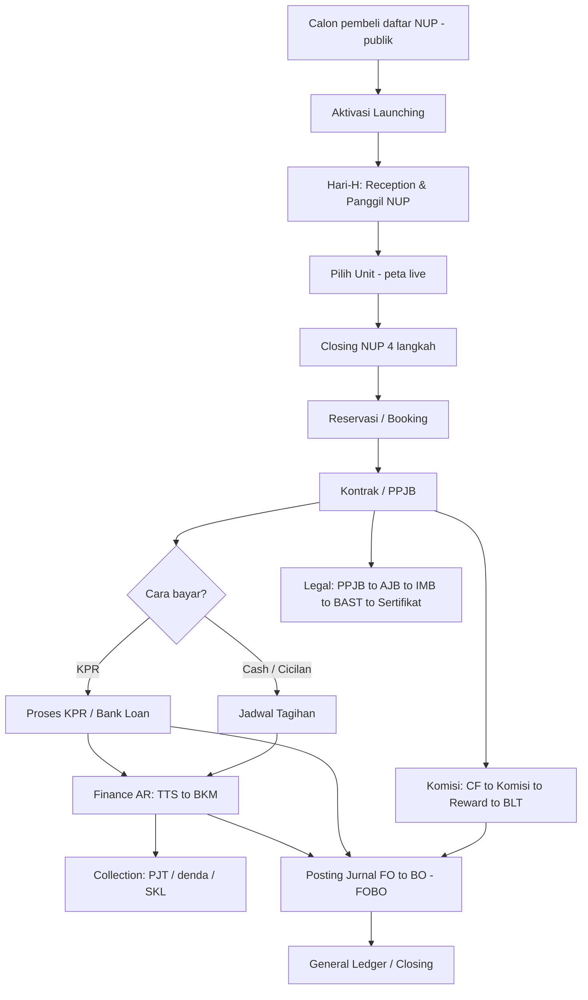

**Aktor lintas tahap:** calon pembeli → sales/marketing → finance AR → KPR officer → legal → collection → accounting.
**Cabang paralel** setelah kontrak: KPR (jika dibiayai bank), Legal (selalu), Finance/Collection (selalu), Komisi (setelah kontrak final/pencairan).

---

## 2. Sub-flow 1 — Registrasi NUP Publik (BR-NUP)

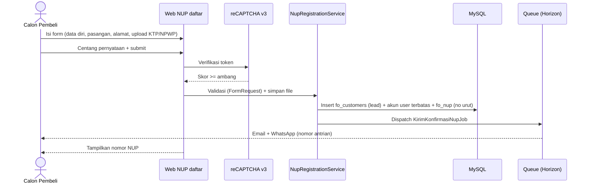

- **Output**: customer (status lead) + entri `fo_nup` (status BOOKING) + notifikasi.
- **Validasi**: NIK, email, ukuran/MIME file (maks 5 MB), captcha.
- **Padanan Laravel**: route publik tanpa auth + rate limit; Livewire/Blade form; FormRequest; Service; Job (email/WA) di queue `email`/`whatsapp`.
- **Internal lanjutan**: tim verifikasi/revisi/lunas-bayar/refund via FO NUP.

---

## 3. Sub-flow 2 — Hari-H Launching (BR-LNC)

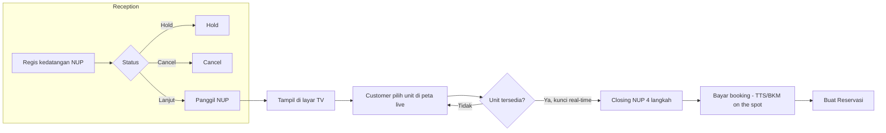

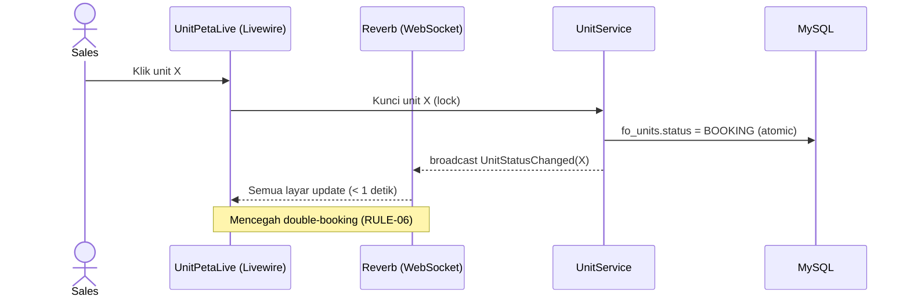

- **Real-time**: legacy SignalR `unitHub` → **Laravel Reverb**, channel presence `project.{id}.units`.
- **Kalkulator skema & ilustrasi KPR** membantu keputusan customer.
- **Status unit**: TERSEDIA → BOOKING (saat dipilih) → TERJUAL (saat closing) / kembali TERSEDIA (jika batal/expire).

---

## 4. Sub-flow 3 — Reservasi & Kontrak/PPJB + Approval (BR-MKT, RULE-03)

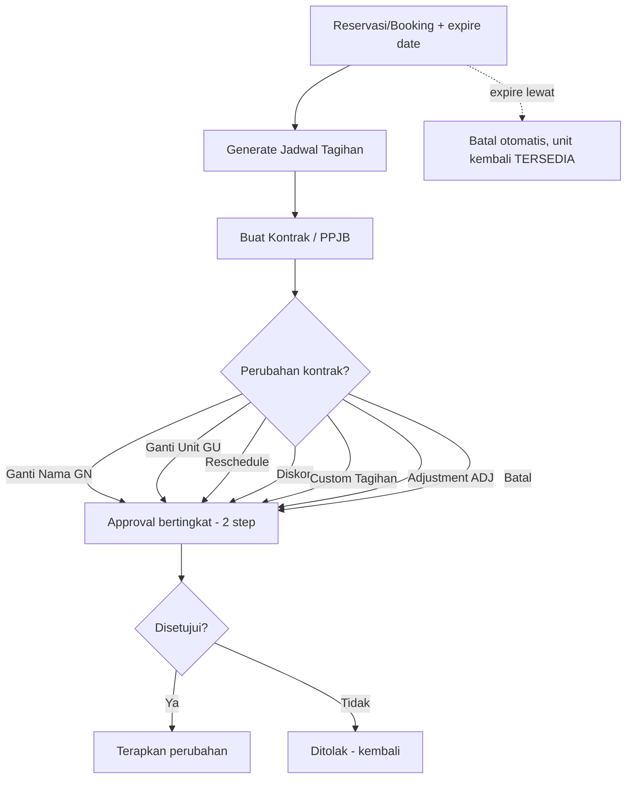

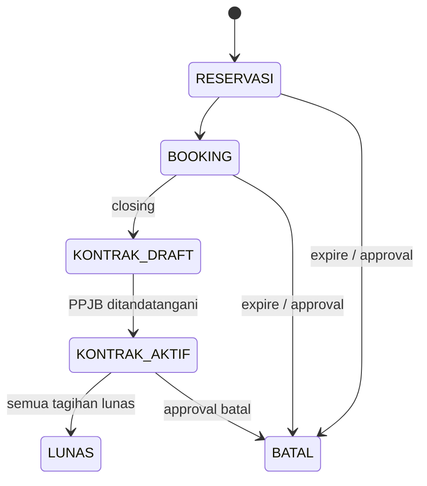

- **Approval**: setiap jenis perubahan (ADJ/Batal/Custom/Diskon/GN/GU/Reschedule) melewati 2 langkah approve sesuai batas wewenang (`fo_approval_detail.limit_nominal`, `urutan`).
- **Padanan Laravel**: Event `KontrakChangeRequested` → masuk antrian approval (`fo_approval`); Policy + middleware untuk wewenang; setelah disetujui jalankan Service penerap perubahan.
- **Expire reservasi** (RULE-02): Scheduler harian menandai reservasi kedaluwarsa & membebaskan unit.

---

## 5. Sub-flow 4 — Proses KPR / Bank Loan (BR-KPR)

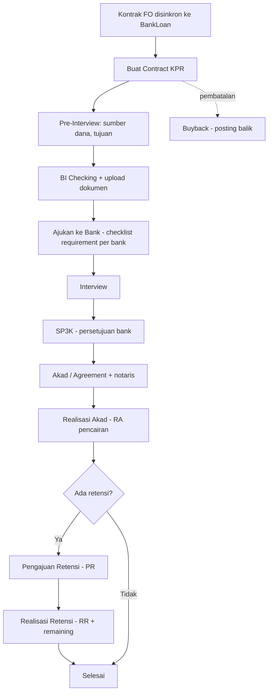

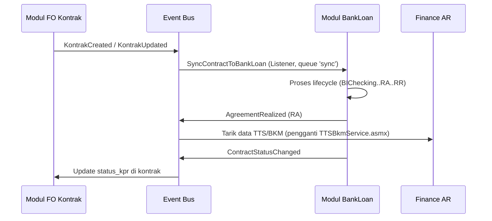

- **Sinkronisasi dua arah** menggantikan stored procedure `SP_FOtoStandAlone_*` legacy dengan **Event/Listener** (queue `sync`), idempotent.
- **Status**: DRAFT → REGISTERED → ACTIVE → CLOSED/CANCELLED (lihat [03_ERD.md §8](03_ERD.md)).
- **Reminder** (BR-KPR-07): Horizon job harian — BI Checking jatuh tempo, pengajuan retensi (output Excel).
- **Retensi** (RULE-05): `remaining_amount` dilacak hingga nol.

---

## 6. Sub-flow 5 — Finance AR (BR-FIN)

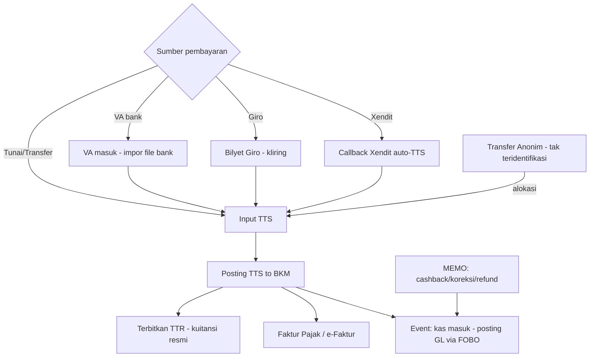

- **TTS → BKM**: TTS (status BELUM_POSTING) → posting → BKM (kumpulan TTS).
- **VA**: impor/ekspor file format bank (BCA/BNI/BRI/Mandiri) — job parsing per bank.
- **Transfer anonim**: dana masuk UNALLOCATED → dialokasikan ke customer/kontrak → jadi TTS.
- **Padanan Laravel**: Service per dokumen; Event `KasMasukPosted` memicu FOBO; Job impor/ekspor VA di queue.

---

## 7. Sub-flow 6 — Collection (BR-COL)

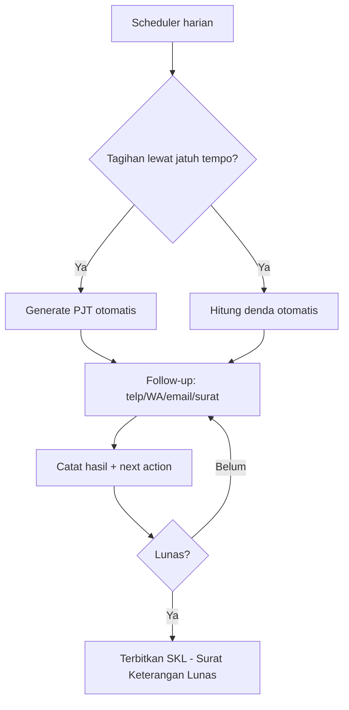

- **PJT & denda otomatis** (BR-COL-01/02, RULE-04): menggantikan `AutoPJT.vbs` & `AutoDenda.vbs` legacy dengan **Scheduler + Job** (queue `default`).
- **Follow-up**: histori per kontrak; grouping untuk distribusi tim.
- **SKL**: saat kontrak LUNAS.

---

## 8. Sub-flow 7 — Legal (BR-LGL)

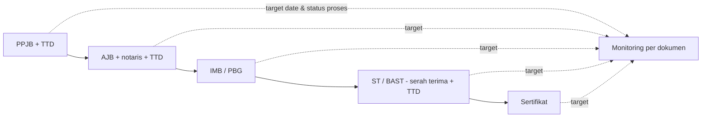

- Setiap dokumen punya **target date**, **status proses**, **TTD**, dan **berkas** pendukung.
- Akad dengan bank tercatat (terhubung ke proses KPR).
- **Padanan Laravel**: satu tabel per jenis dokumen (`fo_legal_*`), Filament/Livewire untuk monitoring target; notifikasi mendekati target date.

---

## 9. Sub-flow 8 — Komisi (BR-KOM)

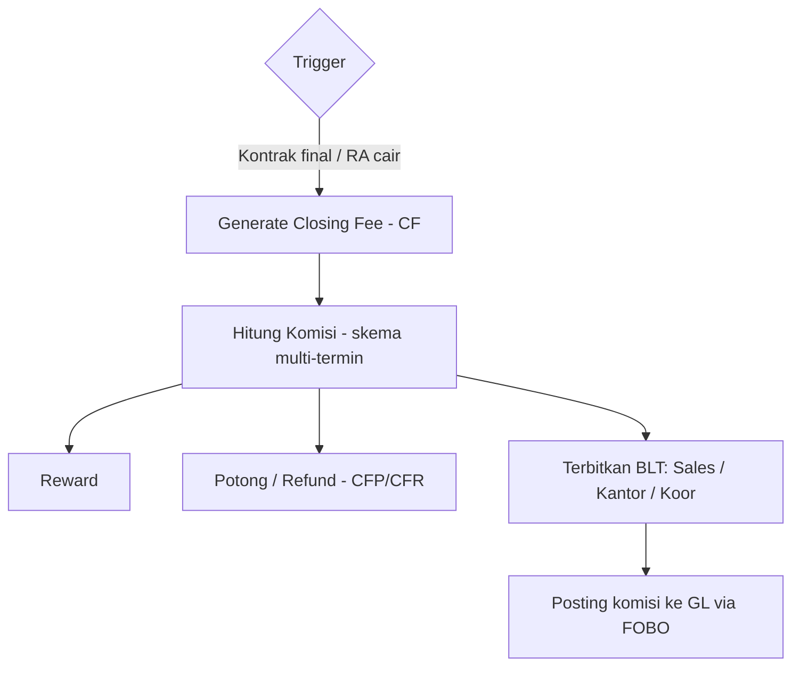

- **Trigger**: setelah kontrak final atau pencairan KPR (event `KontrakFinalized` / `AgreementRealized`).
- **Skema komisi** multi-termin + reward; pemotongan/refund.
- **BLT** 3 jenis (Sales/Kantor/Koordinator) — cetak masing-masing.

---

## 10. Sub-flow 9 — Posting Jurnal FO → BO (FOBO Bridge, BR-ACC-05)

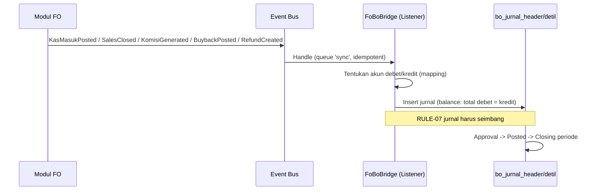

| Event FO | Jurnal BO (ilustratif) |
| --- | --- |
| Kas masuk (BKM) | D: Kas/Bank — K: Piutang/Uang Muka |
| Sales/closing | D: Piutang — K: Pendapatan/Persediaan unit |
| Komisi | D: Beban Komisi — K: Hutang Komisi |
| Buyback | jurnal balik penjualan |
| Refund lebih bayar | D: Hutang Customer — K: Kas/Bank |

- **Padanan Laravel**: menggantikan SP/halaman `FOBO/*.aspx` dengan **Listener** (idempotent, outbox-style). Mapping akun di konfigurasi.

---

## 11. Sub-flow 10 — Pembayaran Xendit (BR-PAY)

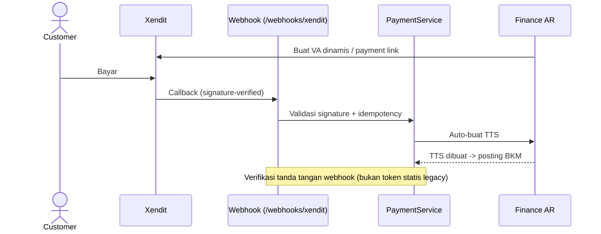

- Menggantikan `XenditPayment.asmx` + `AutoXendit.vbs` legacy.
- **Keamanan**: verifikasi signature webhook (bukan token statis `abc123`).
- **Idempotency**: cegah TTS ganda dari callback berulang (queue `webhook`).

---

## 12. Sub-flow 11 — Backup Terjadwal (BR-BCK)

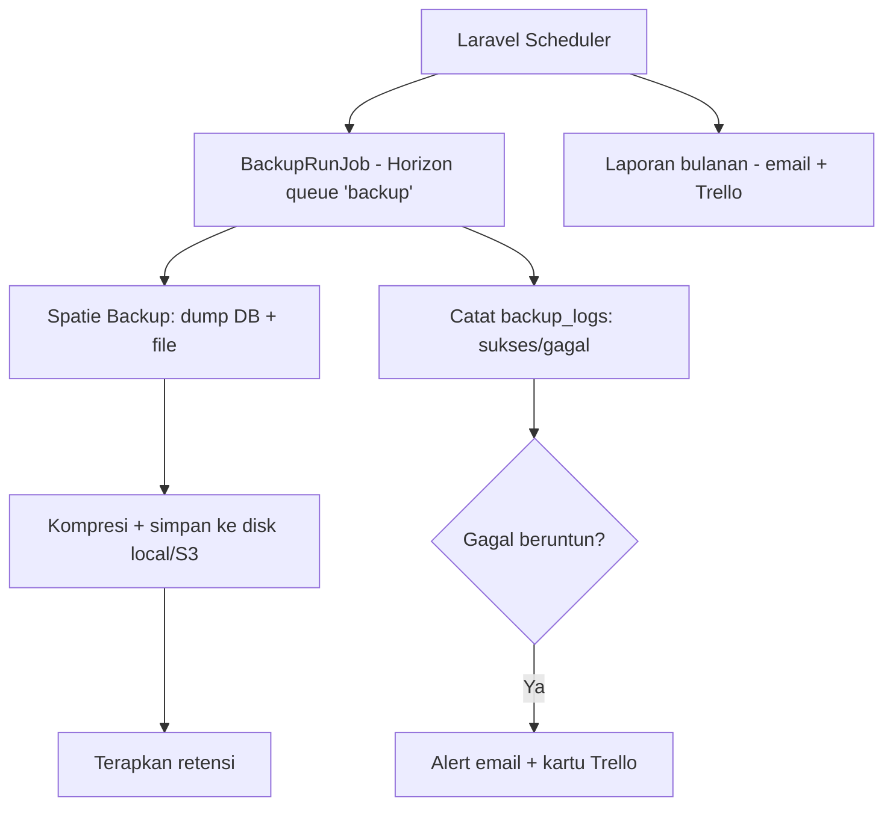

- Menggantikan TuxArch (Windows Service) dengan **Scheduler + Horizon job + Spatie Backup**.
- Dashboard & laporan via Filament (modul Backup).

---

## 13. Status Transition Ringkas (semua entitas berstatus)

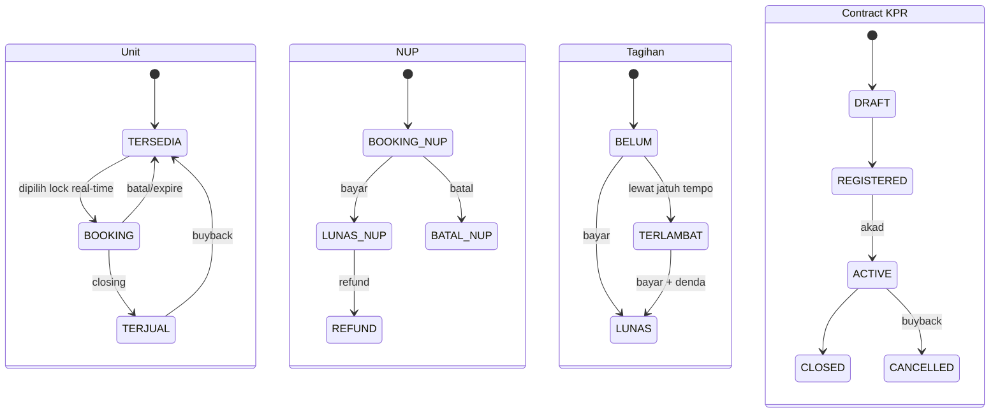

---

## 14. Pemetaan Mekanisme Legacy → Laravel 11

| Mekanisme legacy | Padanan Laravel 11 |
| --- | --- |
| SignalR (`unitHub`) update peta unit | **Laravel Reverb** broadcast (channel presence) |
| Job `.vbs` POST ke `.aspx` (AutoDailyBackUp, AutoDailyReport, AutoDenda, AutoPJT, AutoXendit) | **Scheduler** + **Horizon Job** |
| Stored procedure `SP_FOtoStandAlone_*` (sync FO↔KPR) | **Event/Listener** (queue `sync`, idempotent) |
| Halaman/SP `FOBO/*` posting jurnal | **Listener** outbox-style FO→BO |
| `XenditPayment.asmx` + token statis | **Webhook** dengan verifikasi signature + idempotency |
| `TTSBkmService.asmx` (KPR tarik data BKM) | **Service/Event** internal antar-modul |
| Postback WebForms (UpdatePanel) | **Livewire 3** (FO) / **Filament 3** (BO) |
| Forms-auth per sub-app | **Sanctum + Spatie Permission** (SSO) |
| wkhtmltopdf | **Browsershot** (Puppeteer) / DomPDF |
| Hangfire (KPR) | **Horizon** (Redis) |
| TuxArch Windows Service | **Scheduler + Spatie Backup** |
