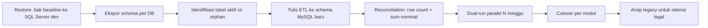

# NFR & Kebutuhan Teknis — eProperty (Target Laravel 11)

**eProperty (Clone) — Non-Functional Requirements & Technical Specification**
Companion: [00_README.md](00_README.md) · [01_BRD.md](01_BRD.md) · [02_PRD.md](02_PRD.md) · [03_ERD.md](03_ERD.md) · [04_BusinessFlow.md](04_BusinessFlow.md)

> "Kebutuhan yang lainnya" — arsitektur teknis Laravel 11, stack, NFR, integrasi eksternal, environment, keamanan kredensial, dan rencana migrasi data.

---

## 1. Identitas & Stack Teknologi

| Komponen | Pilihan (kompatibel Laravel 11) |
| --- | --- |
| Bahasa | PHP **8.2+** (disarankan 8.3) |
| Framework | **Laravel 11** |
| Database | **MySQL 8** (InnoDB, utf8mb4) |
| Cache / Queue / Session / Lock | **Redis 7** |
| Queue manager | **Laravel Horizon** |
| Real-time / WebSocket | **Laravel Reverb** (rilis bersama Laravel 11) |
| Auth | **Laravel Sanctum** + **Spatie laravel-permission** |
| UI FO | **Livewire 3** + Blade + Tailwind + Alpine.js + Laravel Echo |
| UI BO / Backup / System | **Filament 3** (panel) |
| PDF | **Browsershot** (Puppeteer) untuk dokumen kompleks; **DomPDF** fallback |
| Excel | **Maatwebsite/Excel** (atau PhpSpreadsheet) — pertahankan format reminder XLSX |
| Audit log | **Spatie laravel-activitylog** |
| Backup | **Spatie laravel-backup** |
| Object storage | **Flysystem** (local / S3 / MinIO) |
| Web server | Nginx + PHP-FPM (Ubuntu 22.04 LTS), Docker opsional |
| Error tracking | Sentry (opsional) |

> Catatan kompatibilitas: Livewire 3, Filament 3, Reverb, Horizon, Sanctum, dan paket Spatie di atas **mendukung Laravel 11**. Hindari paket yang mensyaratkan Laravel 12.

---

## 2. Arsitektur Target

### 2.1 Monolith modular

```
app/
├── Modules/
│   ├── FO/            (MarketingSales, FinanceAR, Collection, Legal,
│   │                   Launching, KpaView, Komisi, Approval, Adminjual,
│   │                   Dashboard, Settings)
│   ├── BO/            (GeneralLedger, AccountsReceivable, AccountsPayable,
│   │                   CashBank, Inventory, HR, FoBoBridge, Setup)
│   ├── BankLoan/      (Contracts, ContractBanks, BIChecking, Realization,
│   │                   Retention, Buyback, Mom, Reminders, Dashboard)
│   ├── Backup/        (Dashboard, Schedules, Logs, Reports, Config)
│   └── System/        (Users, Roles, Masters, Numerator, Settings, AuditLog)
├── Enums/             (status code, prefix, jenis approval — terpusat)
├── Services/Numerator/
└── ...
```

Tiap modul memiliki: `Controllers/` (atau `Livewire/`), `Models/`, `Requests/` (FormRequest), `Services/` (business logic), `Events/` + `Listeners/`, `Policies/`, `DataTransferObjects/`, dan `routes.php` (di-include dari `routes/modules/<module>.php`).

### 2.2 Pemisahan tanggung jawab

```
Request → Route → Controller (tipis, ≤ ~50 baris) → FormRequest (validasi)
                                                  → Service (business logic)
                                                  → Model (Eloquent: relasi/scope/accessor)
                                                  → Event → Listener (async via queue)
```

- **Controller tipis**; logika kompleks di **Service**.
- **Cross-module** via **Event/Listener** atau Service interface (DI) — bukan akses Model modul lain langsung.
- **Job** untuk pekerjaan async (PDF batch, email/WA blast, backup, sync, impor VA).

### 2.3 Catatan struktur Laravel 11

- Bootstrap ramping: `bootstrap/app.php` (middleware, exception, routing) — **tanpa** `app/Http/Kernel.php` & `app/Console/Kernel.php`.
- Scheduler didefinisikan di `routes/console.php` (atau `bootstrap/app.php` `->withSchedule()`).
- Service Provider tunggal `AppServiceProvider` + provider per modul didaftarkan di `bootstrap/providers.php`.
- Health check route bawaan (`/up`).

### 2.4 Multi-tenant guardrail (opsional, siap)

Kolom `tenant_id` di tabel transaksi + global scope `TenantScope`; bypass hanya untuk admin (`withoutGlobalScope`). Default single-tenant (MUP).

---

## 3. Persyaratan Non-Fungsional (NFR)

### 3.1 Lokalisasi
- UI string di `lang/id/*.php`; `APP_LOCALE=id`, fallback `en` (hanya error developer).
- Format tanggal `dd MMMM yyyy` (panjang) & `dd-MM-yyyy` (pendek); angka pemisah ribuan `.` desimal `,`.
- Timezone `Asia/Jakarta`.
- Istilah domain & enum status tetap Indonesia (lihat [03_ERD.md](03_ERD.md)).

### 3.2 Performa
- Dashboard < 800 ms; form < 500 ms (p95).
- Mendukung ~100 pengguna konkuren.
- **Peta unit live** (launching) update < 1 detik via Reverb.
- Cache Redis untuk dropdown master (banks, projects, accounts) TTL ~1 jam; dashboard 5–15 menit; permission ~1 jam (invalidasi saat role berubah).
- Window backup harian (siang/malam) memperhitungkan DB terbesar (~900 MB BankLoan legacy).

### 3.3 Keamanan
- Password **BCrypt cost 12+** (jangan SHA256 polos seperti TuxArch legacy).
- **2FA (TOTP)** wajib untuk `super_admin`, `finance_manager`, `it_admin`.
- **Login lock**: 30 menit setelah 3 percobaan gagal (`login_attempts`).
- **IP whitelist** untuk endpoint admin (port dari BO `Security/IP.aspx`).
- **CSRF** aktif untuk web; webhook eksternal pakai verifikasi signature, bukan CSRF.
- **Sanctum** untuk API; session di Redis.
- **Session timeout**: BO ~3600 dtk, FO ~600 dtk (configurable).
- **Audit log wajib** untuk semua aksi tulis (Spatie Activitylog) — retensi sesuai kebutuhan legal/pajak.
- Jangan expose Eloquent model di API — pakai **API Resource**.
- File upload: validasi MIME + ukuran + (opsional) ClamAV.

### 3.4 Reliability
- Backup harian + kompresi + retensi (lihat §6); restore teruji (backup drill).
- Alert kegagalan backup beruntun → email + Trello.
- Horizon mengawasi queue; job kritis **idempotent** + `ShouldBeUnique`.
- Logging terstruktur (Monolog/Serilog-style) + audit ke DB untuk legal.

### 3.5 Kompatibilitas
- Format file backup `.bak` **legacy tetap dapat di-restore** ke SQL Server untuk arsip/audit (jangan diubah).
- Format Excel reminder (`Reminder-BI-Checking.xlsx`, `Reminder-Pengajuan-Retensi.xlsx`) — pertahankan kolom & nama sheet.
- Dokumen cetak harus byte-compatible / visual-diff vs legacy (sign-off operator).

---

## 4. Numerator (penomoran dokumen) — wajib atomic

```php
$noKontrak = app(NumeratorService::class)->next('KPR', companyId: $companyId);
// -> 'KPR-2025-00042' (atomic via transaction + row-level lock pada tabel numerators)
```

- Konfigurasi di tabel `numerators` (lihat [03_ERD.md §3](03_ERD.md)): `doc_type`, `prefix`, `period_mode`, `padding`, `company_id`, `period_key`, `last_number`.
- **DILARANG** `MAX(id)+1` / auto-increment murni untuk nomor dokumen (RULE-01).
- Kode KPR verbatim: `KPR`, `RA`, `PR`, `RR`.

---

## 5. Integrasi & Layanan Eksternal

| Layanan | Dipakai modul | Tujuan | Padanan Laravel |
| --- | --- | --- | --- |
| **Xendit** | FinanceAR | VA dinamis, payment link, callback → auto-TTS | Service + Webhook (signature-verified) + queue `webhook` |
| **Google reCAPTCHA v3** | NUP publik | Anti-bot registrasi | Middleware/Service verifikasi skor |
| **SMTP (Gmail/Custom)** | semua | Email transaksional & notifikasi | Mailable + queue `email` |
| **Trello** | Backup | Kartu otomatis laporan/alert | HTTP client + queue |
| **wkhtmltopdf → Browsershot** | semua cetak PDF | Render HTML → PDF | Browsershot (Puppeteer) |
| **Format file VA bank** (BCA/BNI/BRI/Mandiri) | FinanceAR | Impor/ekspor VA | Job parser per format bank |
| **DJP e-Faktur** | FinanceAR, BO | Faktur pajak | Service (CSV / Host-to-Host — TBD) |
| **BI Checking / SLIK** | BankLoan | Upload hasil cek debitur | Upload + simpan dokumen |
| **WhatsApp** | NUP, Collection | Blast nomor NUP / follow-up | Provider abstraksi + queue `whatsapp` |
| **Agenku** (eksternal) | FO | Sync agent/unit | `external_applications` + API |

---

## 6. Backup (pengganti TuxArch)

- **Spatie laravel-backup** + **Scheduler** + **Horizon** (queue `backup`).
- Backup harian (siang & malam), kompresi ZIP, retensi (default 365 hari — **tinjau kebutuhan pajak 10 tahun**, lihat [01_BRD.md §8](01_BRD.md)).
- Tujuan disk: local + S3/MinIO.
- Alert kegagalan beruntun → email + Trello.
- Laporan bulanan otomatis.
- Metadata & UI di modul Backup (Filament): `backup_schedules`, `backup_logs`, `backup_configs`.

```bash
php artisan backup:run            # manual
php artisan backup:clean          # retensi
php artisan backup:list
```

---

## 7. Environment & Konfigurasi (`.env.example`)

```dotenv
APP_NAME=eProperty
APP_ENV=local
APP_DEBUG=true
APP_URL=http://localhost
APP_TIMEZONE=Asia/Jakarta
APP_LOCALE=id
APP_FALLBACK_LOCALE=en

# Database (single MySQL 8)
DB_CONNECTION=mysql
DB_HOST=127.0.0.1
DB_PORT=3306
DB_DATABASE=eproperty
DB_USERNAME=eproperty
DB_PASSWORD=secret

# Redis (cache/session/queue/lock)
REDIS_HOST=127.0.0.1
REDIS_PORT=6379
REDIS_PREFIX=eproperty
CACHE_STORE=redis
SESSION_DRIVER=redis
QUEUE_CONNECTION=redis

# Broadcast (Reverb)
BROADCAST_CONNECTION=reverb
REVERB_APP_ID=
REVERB_APP_KEY=
REVERB_APP_SECRET=
REVERB_HOST=localhost
REVERB_PORT=8080

# Mail
MAIL_MAILER=smtp
MAIL_HOST=smtp.gmail.com
MAIL_PORT=465
MAIL_USERNAME=
MAIL_PASSWORD=
MAIL_ENCRYPTION=ssl
MAIL_FROM_ADDRESS=
MAIL_FROM_NAME="${APP_NAME}"

# Filesystem / Object storage
FILESYSTEM_DISK=local
AWS_ACCESS_KEY_ID=
AWS_SECRET_ACCESS_KEY=
AWS_DEFAULT_REGION=
AWS_BUCKET=
AWS_USE_PATH_STYLE_ENDPOINT=false

# Xendit
XENDIT_SECRET_KEY=
XENDIT_WEBHOOK_TOKEN=

# Google reCAPTCHA v3
RECAPTCHA_SITE_KEY=
RECAPTCHA_SECRET_KEY=
RECAPTCHA_MIN_SCORE=0.5

# Trello (alert backup)
TRELLO_API_KEY=
TRELLO_TOKEN=
TRELLO_BOARD_ID=
TRELLO_LIST_ID=

# WhatsApp (provider TBD)
WHATSAPP_PROVIDER=wablas
WHATSAPP_API_TOKEN=

# Backup
BACKUP_DESTINATION_DISKS=local,s3
BACKUP_NOTIFICATION_EMAIL=
BACKUP_RETENTION_DAYS=365

# Error tracking
SENTRY_LARAVEL_DSN=
```

---

## 8. Keamanan Kredensial (snapshot legacy)

Semua secret di snapshot legacy **dianggap compromised** dan **wajib di-rotate** — hanya berguna sebagai *referensi skema* (DB mana terhubung ke mana, endpoint integrasi apa yang ada). Contoh yang HARUS diganti:

- DB user `eproperty` / `Pass@word1`
- JWT signing key KPR (`A5B25C6B...`, terlalu pendek)
- Token sync statis `abc123` (FO↔KPR/BO) → ganti **HMAC/JWT bertanda tangan**
- `BankLoanAppId/AppSecret`, `AgenkuAppId/Secret`
- SMTP app password, Xendit key, Trello token, GitHub token (TuxArch)
- TuxArch password hash SHA256 + salt → upgrade ke BCrypt/Argon2

Aturan: **tidak ada secret hardcoded**; semua via `.env` + `config()`; jangan commit `.env`.

---

## 9. Rencana Migrasi Data (Legacy SQL Server → MySQL)



| Fase | Aktivitas |
| --- | --- |
| 0 | Restore semua `.bak` tersedia (BO, SECURITY, MARKETINGJUAL, FINANCEAR, MUP_BankLoan) → sumber kebenaran schema. Minta backup prod untuk DB tanpa `.bak`. |
| 1 | Ekspor schema (mssql-scripter / SSMS Generate Scripts) → commit `db/schema/<dbname>.sql`. |
| 2 | Pisahkan tabel aktif vs orphan (banyak tabel sisa versi lama). |
| 3 | ETL ke schema MySQL ([03_ERD.md](03_ERD.md)): mapping tipe (§9 ERD), mapping status code → enum Indonesia, encoding, offset datetime. KPR schema di-reuse hampir as-is. |
| 4 | Reconciliation wajib (row count + sum amount); subset dulu, lalu full. |
| 5 | Dual-run: sistem baru baca-tulis paralel (outbox/trigger) beberapa minggu. |
| 6 | Cutover per modul — disarankan FO `financear` & `marketingjual` lebih dulu (risiko tertinggi), BO terakhir. |
| 7 | Arsip backup legacy untuk retensi legal; rotate-out. |

**Artisan command migrasi** (di `app/Console/Commands/Legacy/`):
```bash
php artisan migrate:legacy --table=<source> --target=<target>
```
Transformasi: status mapping, encoding, datetime offset. Reconciliation script wajib. Uji di staging dengan subset sebelum full.

---

## 10. Perintah Setup & Dev (Laravel 11)

```bash
# Setup awal
composer install
npm install
cp .env.example .env
php artisan key:generate
php artisan storage:link
php artisan migrate --seed

# Dev
php artisan serve
php artisan horizon          # queue worker (WAJIB hidup di dev)
php artisan schedule:work    # scheduler (dev)
php artisan reverb:start     # WebSocket (peta unit live)

# Aset
npm run dev                  # HMR
npm run build                # produksi

# Kualitas kode (sebelum commit)
./vendor/bin/pint            # formatter
./vendor/bin/phpstan analyse # Larastan
php artisan test             # Pest/PHPUnit

# Optimasi produksi
php artisan optimize         # config+route+view+event cache
```

### 10.1 Konvensi kode
- Pint (formatter) + Larastan (static analysis) + Pest (test) wajib lulus sebelum commit.
- snake_case kolom DB, camelCase variabel PHP, PascalCase class.
- Eloquent relationship di Model; eager load untuk hindari N+1; `select()` eksplisit untuk query berat.
- SoftDeletes + trait `Auditable` (`created_by`/`updated_by`/`deleted_by`) di semua model transaksi.
- FormRequest untuk validasi (bukan inline); custom rules di `app/Rules/` (`ValidNik`, `ValidNpwp`, `ValidNomorKontrak`).
- Test: Feature (Controller/Livewire/Route), Unit (Service/DTO), Browser (Dusk) untuk flow kritis (login, reservasi, kontrak, NUP). Pakai `RefreshDatabase` + MySQL test DB.

### 10.2 Queue (Horizon)
Queue: `default`, `sync` (FO↔BO/BankLoan), `pdf`, `email`, `backup`, `whatsapp`, `webhook`. Job idempotent; job kritis `ShouldBeUnique`.

### 10.3 Real-time (Reverb)
Channel: `project.{projectId}.units` (presence, peta launching), `user.{userId}.notifications` (private). Event implement `ShouldBroadcast`; frontend Livewire + Echo.

---

## 11. Larangan (Do-Not)

- ❌ Bypass authorization (`withoutGlobalScope`) di luar konteks admin.
- ❌ `DB::raw()` dengan interpolasi string (SQL injection).
- ❌ Ubah schema produksi tanpa migration file.
- ❌ Commit `.env` / secret.
- ❌ Nomor dokumen via `MAX()+1` / auto-increment murni.
- ❌ Business logic di Eloquent Model (pakai Service).
- ❌ Hapus tabel/kolom tanpa `down()` reversible.
- ❌ Skip Pint/PHPStan/test ("commit later").
- ❌ Ubah/hapus file `.bak` & snapshot legacy (read-only).
