# Diagram Alur per Modul — Java Core System
### Lampiran Diagram · Flowchart Detail Tiap Modul

| | |
|---|---|
| **Versi** | 1.0 · 2026-06-04 |
| **Isi** | Diagram alur (flowchart) detail untuk **setiap modul** — langkah, titik keputusan, dan jurnal otomatis |
| **Pendamping** | `PRD-Java-Core-System` (gambaran) · `Spesifikasi-Modul-Detail` (field & aturan) |

> Diagram menggunakan **Mermaid** (ter-render otomatis di versi HTML & PDF). Notasi: persegi = langkah/aksi · belah ketupat = keputusan · kotak "Jurnal" = posting GL otomatis.

---

# BAGIAN A — FRONT OFFICE (PENJUALAN & CRM)

## 1. CRM — Leads
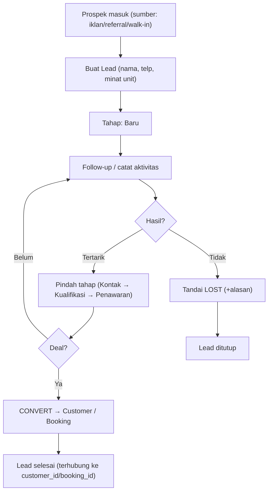

## 2. Customer / CIF
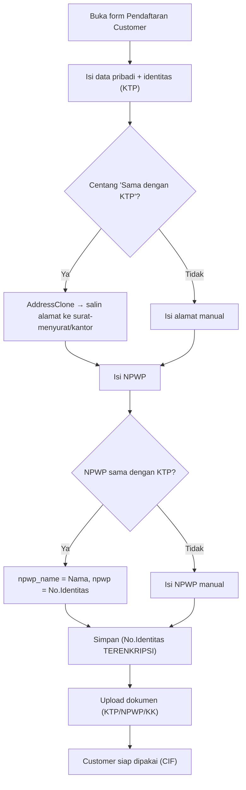

## 3. Master Properti & Siteplan
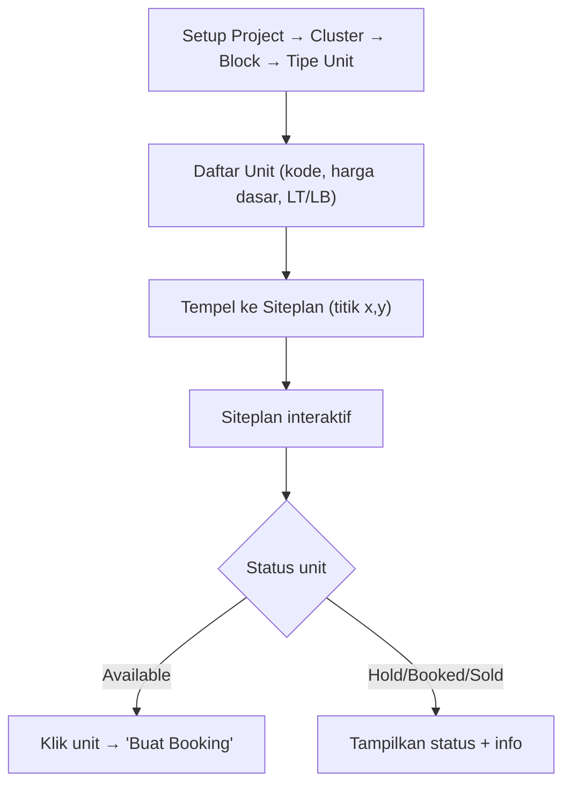

## 4. Pricelist
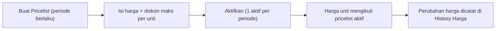

## 5. NUP — Nomor Urut Pemesanan
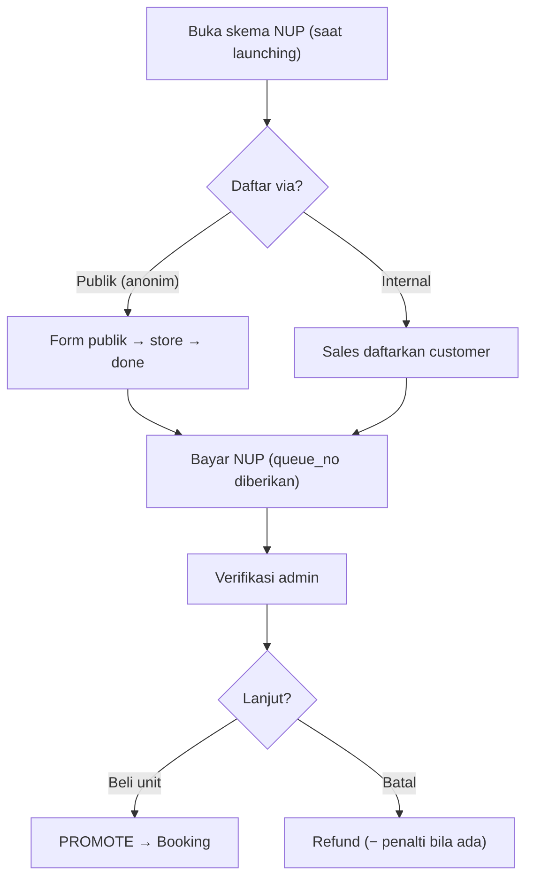

## 6. Hold Unit
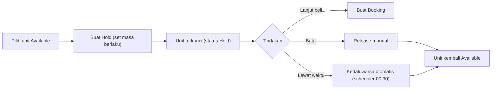

## 7. Booking
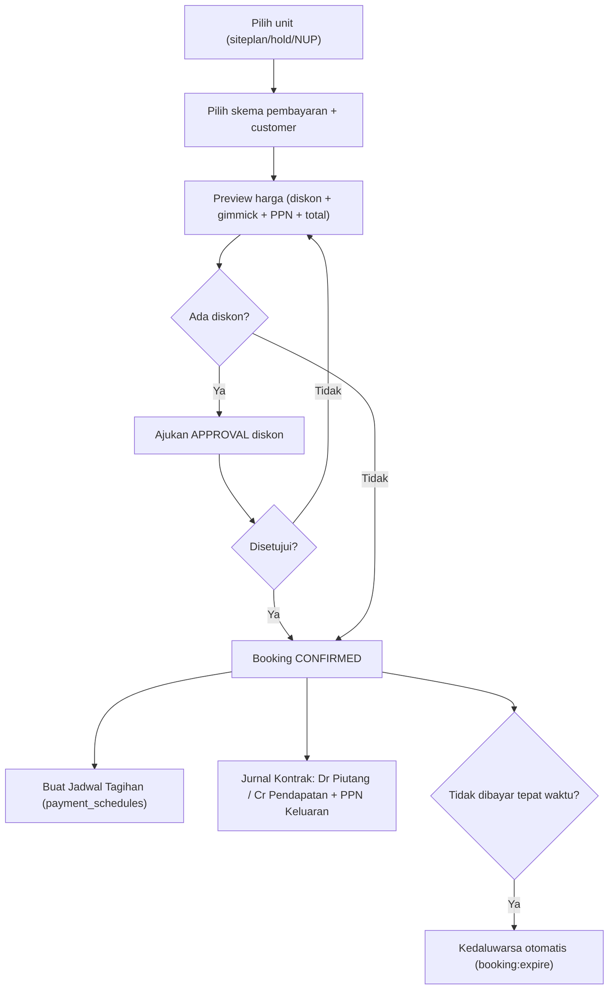

## 8. Contract / PPJB
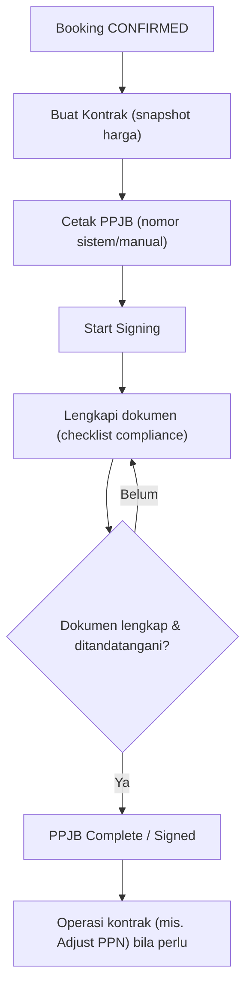

## 9. Gimmick
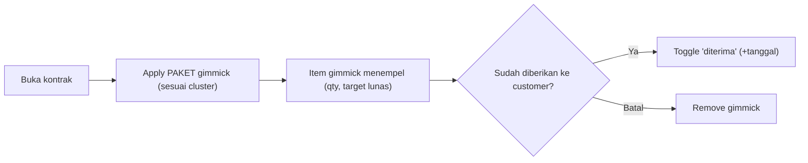

## 10. TTS — Tanda Terima Sementara
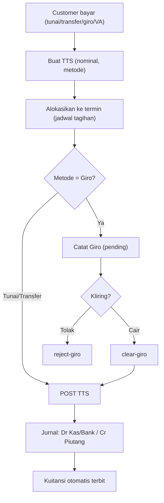

## 11. Kuitansi
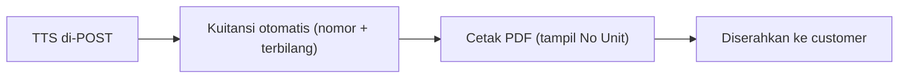

## 12. Memo (Free DP / Subsidi DP)
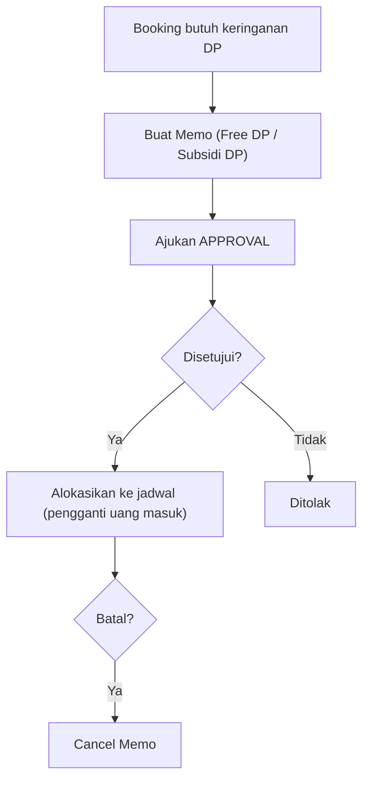

## 13. Cashback & Refund
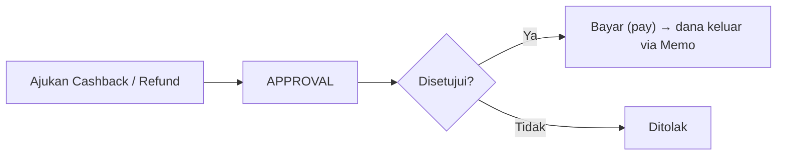

## 14. Komisi
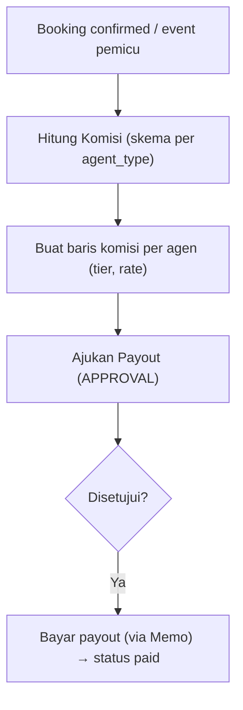

## 15. KPA / Bank Loan
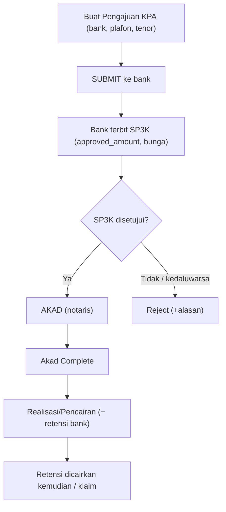

## 16. Legal (AJB/BAST/IMB/Sertifikat)
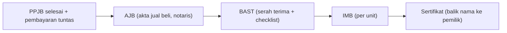

## 17. Collection — Penagihan
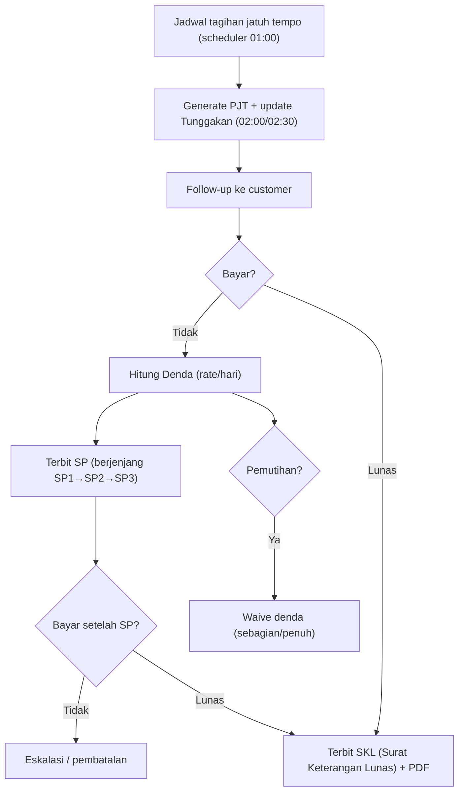

## 18. Exception (GN / GU / Reschedule / Pembatalan)
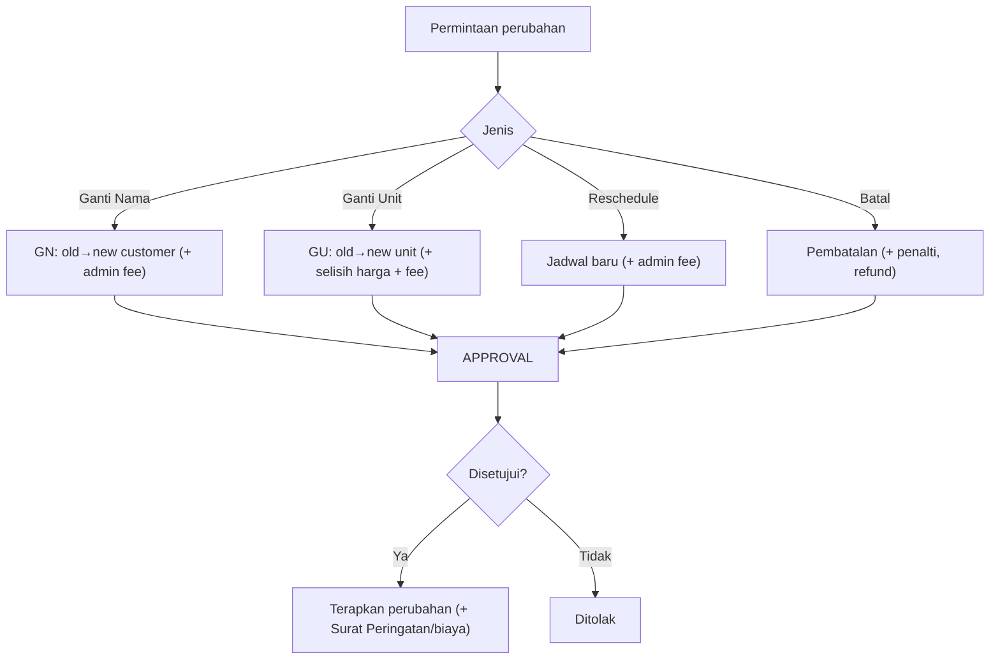

## 19. Virtual Account & Pembayaran
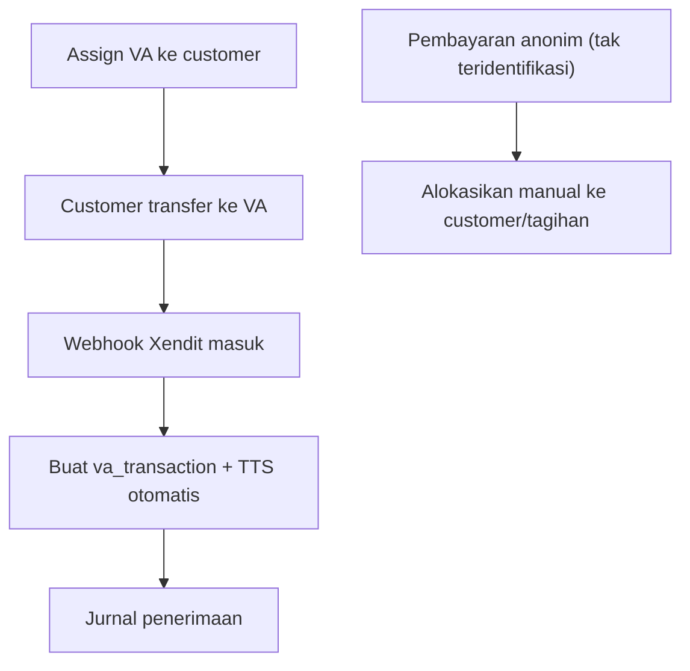

## 20. Faktur Pajak (FO) & 21. Kalkulator
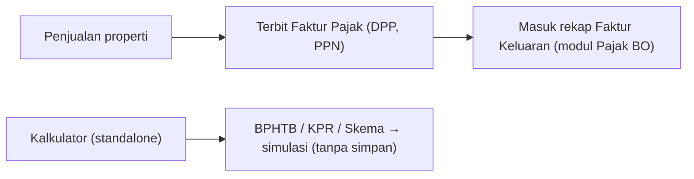

# BAGIAN B — BACK OFFICE / BUSINESS SUPPORT (AKUNTANSI)

## 22–23. Master Akuntansi (CoA & Dimensi)
```mermaid
flowchart LR
  A["Bagan Akun (CoA 6 level)"] --> B["Tandai akun postable (daun)"]
  B --> C["Master Dimensi: Cost Center, Departemen, Ledger, Lokasi"]
  C --> D["Master Supplier"]
  D --> E["Siap dipakai semua transaksi & jurnal"]
```

## 24. General Ledger / Jurnal Manual
```mermaid
flowchart TD
  A["Buat Jurnal Manual (baris Dr/Cr + dimensi)"] --> B{"Total Dr = Cr & periode terbuka?"}
  B -->|"Tidak"| A
  B -->|"Ya"| C["Status: Baru"]
  C --> D["Finalize"]
  D --> E{"Approve?"}
  E -->|"Approve"| F["POSTED ke Buku Besar"]
  E -->|"Reject"| C
  G["Import CSV (REFERENSI)"] --> H{"Dry-run?"}
  H -->|"Ya"| I["Cek saja (tidak disimpan)"]
  H -->|"Tidak"| J["Posting per jurnal (validasi balance)"]
```

## 25. Hutang — AP (Invoice → Kuitansi → Pajak)
```mermaid
flowchart TD
  A["Buat Invoice Hutang (No.Invoice Supplier WAJIB)"] --> B["Isi DPP, PPN, PPh, jadwal, Struktur jurnal"]
  B --> C["Jurnal: Dr Beban/Persediaan + PPN Masukan / Cr Hutang"]
  C --> D["Status: OPEN"]
  D --> E["Kuitansi Hutang (bayar 1+ invoice)"]
  E --> F["Jurnal: Dr Hutang / Cr Kas"]
  F --> G{"Lunas?"}
  G -->|"Ya"| H["Status: PAID"]
  D --> I["Set NSFP → Faktur Masukan"]
  D --> J{"Penyesuaian?"}
  J -->|"Non-tunai"| K["Memorial Hutang"]
  J -->|"Hapus"| L["Penghapusan (write-off)"]
```

## 26. Piutang — AR (Tagih → Reschedule → Terima)
```mermaid
flowchart TD
  A["Buat Invoice Piutang (DPP, PPN, PPh, jadwal)"] --> B["Jurnal: Dr Piutang / Cr Pendapatan + PPN Keluaran"]
  B --> C["Status: OPEN"]
  C --> D{"Perlu jadwal ulang?"}
  D -->|"Ya"| E["RESCHEDULE sisa (angsuran terbayar dikunci) — tanpa jurnal"]
  D -->|"Tidak"| F["Kuitansi Piutang (terima bayar)"]
  E --> F
  F --> G["Jurnal: Dr Kas / Cr Piutang"]
  G --> H{"Lunas?"}
  H -->|"Ya"| I["Status: PAID"]
```

## 27–28. Kas/Bank & Kas Kecil
```mermaid
flowchart TD
  A["Transaksi kas/bank"] --> B{"Jenis"}
  B -->|"Masuk"| C["Jurnal: Dr Kas/Bank / Cr Sumber"]
  B -->|"Keluar"| D["Jurnal: Dr Beban / Cr Kas/Bank"]
  E["Kas Kecil"] --> F{"Jenis"}
  F -->|"Top-up"| G["Jurnal: Dr Kas Kecil / Cr Bank"]
  F -->|"Belanja"| H["Jurnal: Dr Beban / Cr Kas Kecil"]
```

## 29. Bon Sementara (Uang Muka)
```mermaid
flowchart TD
  A["Terbitkan Panjar"] --> B["Jurnal: Dr Uang Muka / Cr Kas"]
  B --> C["Realisasi (input beban)"]
  C --> D["Jurnal: Dr Beban / Cr Uang Muka"]
  D --> E{"Selisih?"}
  E -->|"Sisa (kembali)"| F["REFUND → Dr Kas / Cr Uang Muka"]
  E -->|"Kurang (nombok)"| G["REIMBURSE → Dr Uang Muka / Cr Kas"]
  E -->|"Pas"| H["Selesai (settled)"]
```

## 30. Cek / Giro Masuk
```mermaid
flowchart TD
  A["Terima Giro dari customer"] --> B["Jurnal: Dr Piutang Giro / Cr counter"]
  B --> C["Status: In Hand"]
  C --> D{"Jatuh tempo"}
  D -->|"Cair"| E["KLIRING → Dr Bank / Cr Piutang Giro (cleared)"]
  D -->|"Tolak"| F["BOUNCE → balik jurnal (bounced)"]
```

## 31. Rekonsiliasi Bank
```mermaid
flowchart LR
  A["Pilih akun + saldo rekening koran"] --> B["Cocokkan baris buku ↔ koran"]
  B --> C["Centang baris cleared"]
  C --> D{"Saldo cocok?"}
  D -->|"Ya"| E["FINALIZE"]
  D -->|"Tidak"| B
```

## 32. Aset Tetap
```mermaid
flowchart TD
  A["Registrasi Aset (harga, umur, akun)"] --> B["Jurnal perolehan: Dr Aset / Cr Dana"]
  B --> C["Penyusutan periodik / batch"]
  C --> D["Jurnal: Dr Beban Penyusutan / Cr Akumulasi"]
  D --> E{"Pelepasan?"}
  E -->|"Hapus"| F["Dr Akum + Rugi / Cr Aset (disposed)"]
  E -->|"Jual"| G["Dr Kas+Akum / Cr Aset + Laba | − Rugi (sold)"]
  H["Migrasi aset berjalan"] --> I["Saldo Awal Penyusutan: Dr Laba Ditahan / Cr Akumulasi"]
```

## 33. Persediaan / Stock
```mermaid
flowchart TD
  A["FPB / Permintaan Barang"] --> B["Approve FPB"]
  B --> C{"Pergerakan"}
  C -->|"Penerimaan"| D["Dr Persediaan / Cr Sumber + update Kartu Stok (in)"]
  C -->|"Pengeluaran"| E["Dr Beban/CIP / Cr Persediaan + Kartu Stok (out)"]
```

## 34. Pembelian / PO
```mermaid
flowchart TD
  A["Buat PO (baris item, PPN)"] --> B["Approve PO"]
  B --> C{"Tindakan"}
  C -->|"Revisi"| D["Edit baris + hitung ulang (revision_count++)"]
  C -->|"Posting Termin"| E["Uang Muka: Dr Uang Muka Pembelian / Cr Kas"]
  C -->|"Adjust PPN"| F["Set ulang % PPN + total"]
  C -->|"Selesai"| G["Close PO"]
```

## 35. Kontraktor / SPK
```mermaid
flowchart TD
  A["Buat SPK (nilai kontrak, retensi%, PPN%)"] --> B["Progress termin"]
  B --> C["Jurnal: Dr CIP + PPN / Cr Hutang + Retensi"]
  C --> D["Bayar termin: Dr Hutang / Cr Kas"]
  A --> E{"Aksi lain (SPK aktif)"}
  E -->|"Addendum"| F["± nilai kontrak (guard ≥ progress)"]
  E -->|"Adjust PPN"| G["PPN progress berikutnya"]
  E -->|"Pemakaian Barang"| H["Dr CIP / Cr Persediaan"]
  E -->|"Mutasi Progress"| I["Dr CIP-tujuan / Cr CIP-asal"]
  E -->|"Batalkan"| J["status Cancelled (guard: tak ada unpaid/retensi)"]
  D --> K["Cairkan Retensi: Dr Hutang Retensi / Cr Kas → SPK Closed"]
```

## 36. Budget Control
```mermaid
flowchart TD
  A["Alokasi anggaran (tahun/akun/cost-center)"] --> B["Status: Draft"]
  B --> C["AJUKAN (submit)"]
  C --> D{"Setujui?"}
  D -->|"Approve"| E["Status: Disetujui"]
  D -->|"Reject"| F["Status: Ditolak"]
  E --> G{"Mutasi?"}
  G -->|"Transfer"| H["Pindah nilai antar baris anggaran"]
  G -->|"Koreksi"| I["Sesuaikan nilai 1 baris"]
  E --> J["Tampil Budget vs Realisasi (Σ jurnal beban)"]
```

## 37. COGS / HPP RealCost
```mermaid
flowchart TD
  A["Akumulasi biaya CIP per cluster"] --> B["GENERATE RealCost (pilih proyek + akun CIP)"]
  B --> C["Hitung biaya/unit (rata | proporsi harga)"]
  C --> D["Tampil unit: terjual / sudah-diakui / belum"]
  D --> E["Pilih unit terjual & belum diakui"]
  E --> F["POSTING HPP: Dr Beban Pokok / Cr CIP"]
  F --> G["Unit ditandai recognized (idempoten)"]
```

## 38. Payroll
```mermaid
flowchart TD
  A["Run Payroll (periode, % PPh21, % BPJS)"] --> B["Hitung tiap karyawan aktif (bruto, potongan, net)"]
  B --> C["Jurnal: Dr Beban Gaji / Cr PPh21 + BPJS + Kas"]
  C --> D["Payslip per karyawan"]
```

## 39. Pajak (e-Faktur & SPT)
```mermaid
flowchart TD
  A["Invoice AR/AP ber-PPN"] --> B["Set NSFP (no. seri faktur)"]
  B --> C["Rekap Faktur Keluaran / Masukan"]
  C --> D{"Output"}
  D -->|"e-Faktur"| E["Export CSV / XML (skema DJP)"]
  D -->|"SPT Masa"| F["Cetak SPT PPN / PPh + Bukti Potong"]
  C --> G["Dashboard Pajak (jatuh tempo setor/lapor)"]
```

## 40. Tutup Buku
```mermaid
flowchart TD
  A["Input transaksi sepanjang bulan"] --> B["TUTUP BULANAN → kunci periode"]
  B --> C{"Coba posting ke periode terkunci?"}
  C -->|"Ditolak"| D["Periode aman"]
  B --> E["...akhir tahun..."]
  E --> F["TUTUP TAHUNAN → Jurnal penutup"]
  F --> G["Dr Pendapatan / Cr Beban / (Cr|Dr) Laba Ditahan"]
  G --> H["Neraca Awal tahun berikutnya (carry-forward)"]
```

## 41. Upload Massal & Proyeksi
```mermaid
flowchart LR
  A["Upload CSV (Aset / Anggaran / Saldo Awal Stok)"] --> B{"Dry-run?"}
  B -->|"Ya"| C["Cek + laporan error per-baris"]
  B -->|"Tidak"| D["Simpan massal (+ jurnal saldo awal stok)"]
  E["Proyeksi Hutang/Piutang"] --> F["Bucket Jatuh Tempo + 12 bulan per supplier/customer"]
```

---

# BAGIAN C — SECURITY, SETUP & SETTINGS

## 42–44. Security / Setup Sales / Settings
```mermaid
flowchart TD
  A["Security (SDM lapangan)"] --> A1["Absensi · Riwayat Jabatan · Tiket Teknis · Matrikulasi akses"]
  B["Setup Sales"] --> B1["Skema Bayar · Sales · Agent · Pricelist · Sumber Data"]
  C["Settings"] --> C1["User (MFA, blokir gagal login) · Role/Permission · Numerator · Parameter · Notifikasi"]
```

---

## Catatan
Diagram di atas menyederhanakan alur utama tiap modul; rincian field, status, dan aturan ada di **`Spesifikasi-Modul-Detail`**. Untuk diagram arsitektur & ERD lihat **`PRD-Java-Core-System` (Lampiran D)**.

*— Java Core System · 2026-06-04 —*
