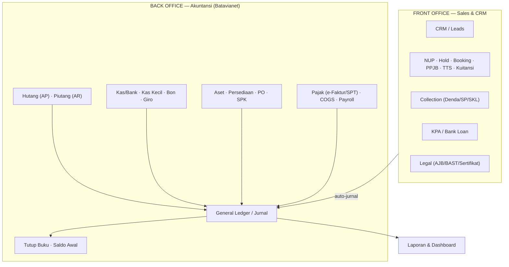
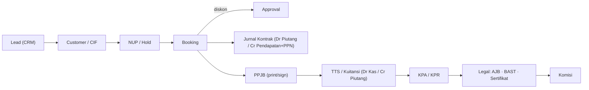
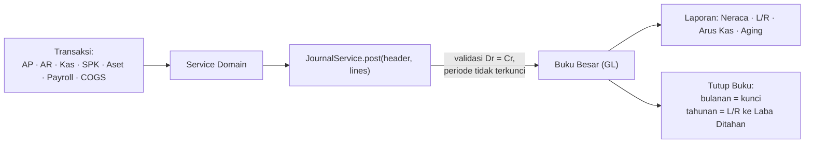
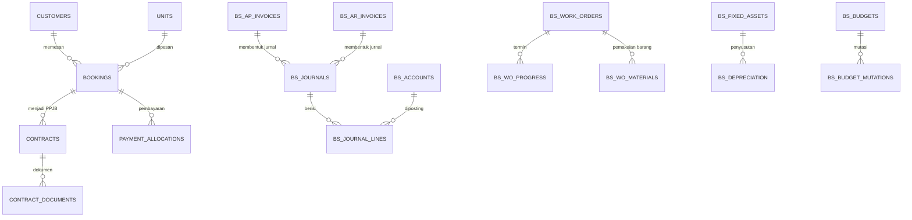
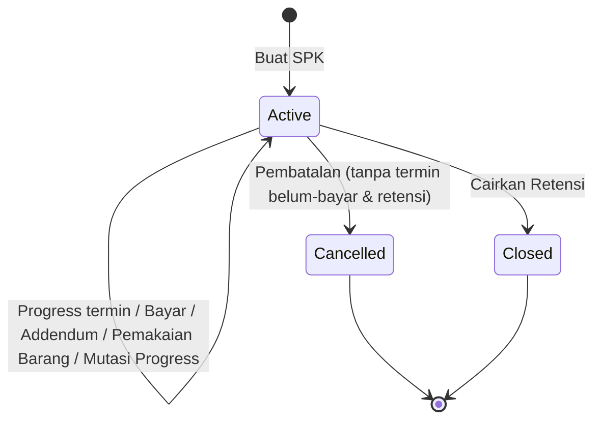
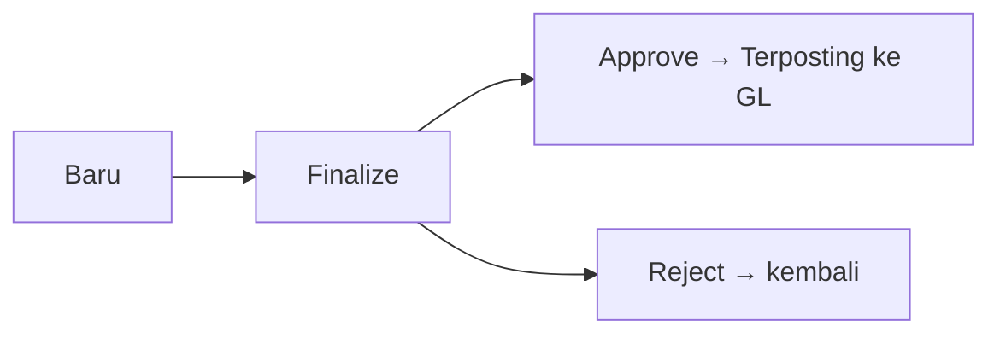

# PRD — Java Core System
### Product Requirements Document (Dokumen Kebutuhan Produk)

| | |
|---|---|
| **Produk** | Java Core System — ERP Pengembang Properti (Sales + Akuntansi) |
| **Pemilik** | PT. Mitra Usaha Propertindo (MUP) |
| **Versi dokumen** | 1.0 |
| **Tanggal** | 2026-06-04 |
| **Status** | Production-ready (terverifikasi: 171 halaman render OK, 24 skenario trial PASS, E2E 39 sub-transaksi balanced) |
| **Acuan kesetaraan** | eProperty — FO `fo.javaresidence.com` + BO `bo.javaresidence.com` ("Batavianet") |

> **Cara baca dokumen ini:** Bab 1–7 = gambaran & aturan umum (baca dulu). Bab 8–11 = rincian tiap modul. Bab 12–21 = data, integrasi, non-fungsional, pengujian, deployment, glosarium. Lampiran A–C = peta route, peran, dan bagan akun.

---

## Daftar Isi
1. Ringkasan Eksekutif
2. Latar Belakang & Masalah
3. Tujuan, Sasaran & Metrik Sukses
4. Ruang Lingkup (In / Out)
5. Persona & Peran Pengguna (RBAC)
6. Arsitektur & Teknologi
7. Prinsip & Aturan Bisnis Lintas-Modul
8. Modul Fungsional — Front Office (Sales, CRM, Collection, KPA, Legal)
9. Modul Fungsional — Back Office / Business Support (Akuntansi)
10. Modul Fungsional — Security, Setup Sales, Settings
11. Laporan & Dashboard
12. Model Data (ERD ringkas)
13. Integrasi Eksternal
14. Kebutuhan Non-Fungsional
15. Alur Kerja Utama (User Journeys)
16. Penjurnalan Otomatis (Journal Templates)
17. Penomoran Dokumen (Numerator)
18. Pengujian & Kriteria Penerimaan
19. Deployment & Operasional
20. Roadmap, Di Luar Lingkup & Risiko
21. Glosarium
- Lampiran A: Peta Route Lengkap
- Lampiran B: Daftar Peran & Domain Permission
- Lampiran C: Bagan Akun Inti & Pemetaan Jurnal

---

## 1. Ringkasan Eksekutif

**Java Core System** adalah aplikasi ERP berbasis web untuk pengembang properti yang menyatukan **dua dunia** dalam satu sistem:

- **Front Office (FO) — Penjualan & CRM:** dari prospek (lead) → NUP → hold unit → booking → kontrak (PPJB) → pembayaran (TTS/Kuitansi) → KPA/KPR → legal (AJB/BAST/Sertifikat) → komisi → penagihan (collection).
- **Back Office (BO) — Akuntansi penuh ("Batavianet"):** General Ledger berbasis **double-entry**, Kas/Bank, Hutang (AP), Piutang (AR), Aset Tetap, Persediaan, Pembelian (PO), Kontraktor (SPK), Budget, COGS, Payroll, Pajak (e-Faktur/SPT), dan Tutup Buku.

Setiap transaksi finansial **otomatis membentuk jurnal GL yang seimbang (Debit = Kredit)**. Sistem merupakan **rebuild setia (faithful clone)** dari eProperty/Batavianet milik MUP, dengan UI modern (Inertia + Vue 3 + Tailwind, dark-mode), RBAC granular, audit trail, dan dukung multi-tenant.

**Status:** seluruh alur teruji end-to-end; tidak ada sub-menu BO/FO yang teridentifikasi tertinggal.

---

## 2. Latar Belakang & Masalah

MUP menjalankan operasi penjualan + akuntansi melalui eProperty (FO) dan Batavianet (BO) — dua sistem warisan berbasis ASPX yang **terpisah, sulit dikustomisasi, dan tidak modern**. Kebutuhan:

- **Satu sistem terpadu** Sales ↔ Akuntansi (booking otomatis menghasilkan jurnal kontrak; pembayaran otomatis ke buku besar).
- **Akurasi akuntansi** (double-entry yang dijamin seimbang, periode terkunci, audit trail).
- **Kepatuhan pajak Indonesia** (PPN, PPh 21/23/4(2), e-Faktur, SPT Masa).
- **UI modern & cepat**, bisa dipakai banyak user, di mana saja.
- **Kemampuan kustomisasi penuh** (kode dimiliki sendiri).

---

## 3. Tujuan, Sasaran & Metrik Sukses

| Tujuan | Sasaran terukur |
|---|---|
| Kesetaraan fitur dengan eProperty/Batavianet | 100% sub-menu FO + BO teridentifikasi terimplementasi |
| Integritas akuntansi | 100% jurnal otomatis **seimbang**; periode tertutup tak bisa diposting |
| Keandalan | Semua halaman (171) render tanpa error; 24 skenario alur inti lulus otomatis |
| Kepatuhan pajak | Output e-Faktur (CSV/XML) & SPT Masa (PPN/PPh) sesuai skema DJP |
| Kemudahan pakai | UI Indonesia, dark-mode, pencarian, dropdown ber-cari, wizard multi-langkah |
| Keamanan | RBAC 193 permission / 11 role; audit trail; data sensitif terenkripsi |

---

## 4. Ruang Lingkup

### 4.1 Termasuk (In Scope)
- Modul FO penuh: Customer/CIF, Unit/Siteplan, Pricelist, NUP, Hold, Booking, Contract/PPJB, Gimmick, TTS, Kuitansi, Memo, Cashback, Refund, Komisi, KPA/Bank Loan, Legal, Collection, Exception (GN/GU/Reschedule), Virtual Account, Faktur Pajak, CRM Leads, Kalkulator (BPHTB/KPR/Skema).
- Modul BO penuh: CoA, GL/Jurnal (+approval lifecycle), Cash Book, Petty Cash, Bon Sementara, Cek/Giro, AP, AR, Fixed Asset, Inventory/Stock, Purchasing/PO, Contractor/SPK, Budget, COGS (+RealCost), Payroll, Pajak (e-Faktur/SPT/PPh), Tutup Buku (bulanan + tahunan), Saldo Awal, Upload Massal, Rekonsiliasi Bank.
- Laporan: Neraca, Laba/Rugi, Arus Kas (langsung+tak langsung), Neraca Lajur, Komparasi, Buku Besar, Neraca Saldo, GL Lanjutan, Proyeksi Hutang/Piutang, Aging, Kartu Hutang/Piutang.
- Lintas: RBAC, audit trail, numerator, parameter sistem, multi-tenant, PDF, notifikasi, scheduler.

### 4.2 Tidak Termasuk (Out of Scope) — saat ini
- Aplikasi mobile native (web responsif tersedia).
- Integrasi bank host-to-host real-time (VA via webhook didukung; rekonsiliasi manual/impor).
- Migrasi data historis otomatis dari eProperty (disediakan **Upload Massal** + **Saldo Awal** sebagai jalurnya).
- BI/analitik lanjutan di luar laporan standar.

---

## 5. Persona & Peran Pengguna (RBAC)

Model otorisasi: **Spatie Laravel-Permission** — **193 permission** dikelompokkan dalam 15 domain: `system, master, sales, finance, collection, bankloan, legal, commission, approval, reporting, businesssupport, crm, security, setupsales, incentive`. **`Gate::before`** memberi **SuperAdmin** akses penuh otomatis.

**11 Peran bawaan:**

| Peran | Fokus |
|---|---|
| **SuperAdmin** | Akses penuh seluruh sistem (bypass permission) |
| **Direktur** | Lihat semua + persetujuan tingkat atas |
| **Admin** | Administrasi sistem, user, parameter |
| **SalesDirector / SalesManager / Sales** | Penjualan: lead→booking→kontrak, sesuai tingkat (approval diskon, dll.) |
| **Agent** | Mitra penjual: lihat unit, daftar prospek, komisi |
| **FinanceManager / Finance** | Akuntansi penuh / transaksi & posting (Business Support, AP/AR, kas) |
| **Collection** | Penagihan: followup, denda, SP, SKL, tunggakan |
| **Viewer** | Hanya-baca |

**Konvensi permission** (contoh Business Support): `businesssupport.view` (lihat), `businesssupport.transaction.create` (buat transaksi/jurnal), `businesssupport.setup.manage` (master/setup), `businesssupport.approval.act` (setujui/tutup periode). Pola serupa untuk domain lain.

---

## 6. Arsitektur & Teknologi

| Lapisan | Teknologi |
|---|---|
| **Bahasa/Runtime** | PHP 8.4 |
| **Framework** | Laravel 12 |
| **Frontend** | Inertia.js + Vue 3 + TypeScript + Tailwind CSS (dark-mode), Vite |
| **Database** | SQLite (default; WAL untuk konkurensi) — siap migrasi MySQL/PostgreSQL |
| **Auth & RBAC** | Laravel Auth + Spatie Permission (+ `Gate::before` SuperAdmin) |
| **PDF** | Browsershot (headless Chromium) untuk Kuitansi, SKL, SPT, dll. |
| **Pola domain** | **DDD-lite**: `app/Domain/<Konteks>/{Models, Services, Actions}` |
| **Komponen UI** | Komponen reusable (Button, Badge, SearchSelect ber-cari, EmptyState, Modal, dll.) |

**Statistik kode:** 72 migrasi/tabel · 152 model domain · 49 controller Business Support · 22 enum · ~300 named route.

**Pola kunci:**
- **Trait `HasTenant`** — otomatis isi `tenant_id` + scope query per tenant (multi-perusahaan).
- **Trait `HasAuditTrail`** — catat perubahan (siapa, kapan, apa) untuk jejak audit.
- **Cast `EncryptedString`** — enkripsi data sensitif (mis. No. Identitas/KTP customer, NPWP agen).
- **Strict-mode Eloquent** — mengakses atribut/relasi yang belum di-load akan error (mencegah bug diam-diam & N+1).
- **`JournalService::post(header, lines)`** — satu pintu posting jurnal: validasi **Dr = Cr**, minimal 2 baris, periode tidak tertutup; menyalurkan dimensi (cost center, departemen, ledger, lokasi, mata uang, kurs) per baris.

---

## 7. Prinsip & Aturan Bisnis Lintas-Modul

1. **Double-entry wajib & seimbang.** Setiap jurnal: total Debit = total Kredit, ≥ 2 baris. Posting yang tak seimbang **ditolak**.
2. **Bagan Akun (CoA) 6 level.** Panjang kode 1/3/5/7/9/11 → level 1–6; hanya akun *postable* (level daun) boleh dijurnal. Tipe akun (aset/liabilitas/ekuitas/pendapatan/beban) diturunkan dari digit pertama kode.
3. **Periode fiskal.** Tutup buku **bulanan = mengunci** periode (tak bisa tambah jurnal); tutup buku **tahunan = jurnal penutup** L/R → Laba Ditahan.
4. **Approval Engine generik.** Transaksi tertentu (diskon booking, cashback, refund, jurnal manual, budget, dll.) melewati alur persetujuan (pending → approved/rejected) sesuai peran.
5. **Numerator** — penomoran dokumen otomatis & unik per jenis & periode (lihat Bab 17).
6. **Soft-delete** untuk entitas penting (audit & pemulihan); data uji/E2E selalu di-rollback.
7. **Idempotensi & guard bisnis** — mis. HPP per unit tak bisa dobel, panjar tak bisa dilepas 2×, aset tak bisa dijual 2×, progres SPK tak bisa dimutasi melebihi yang ada.
8. **Lokalisasi** — bahasa Indonesia, zona waktu Asia/Jakarta, format Rupiah.
9. **Keamanan data** — `APP_DEBUG=false` di produksi, HTTPS, cookie aman, file sensitif (.env, /storage, /database) tak diakses publik.

---

## 8. Modul Fungsional — Front Office (Sales, CRM, Collection, KPA, Legal)

### 8.1 CRM — Leads
Kanban prospek dengan tahapan (LeadStage). Fitur: buat/ubah lead, **pindah tahap** (drag), **funnel**, catat **aktivitas/follow-up**, tandai **lost** (alasan), **convert** lead → Customer/Booking.

### 8.2 Customer / CIF
- Pendaftaran customer lengkap (data pribadi, identitas, NPWP, alamat KTP & domisili, pekerjaan, dll.) dengan **AddressClone** ("sama dengan KTP").
- **NPWP:** Nama & No. NPWP di bawah Alamat NPWP; centang "Sama dengan KTP" → Nama NPWP = Nama Lengkap, No. NPWP = No. Identitas.
- **CIF** (Customer Information File): profil 360° + riwayat.
- **Merge** customer ganda (+ pemetaan referensi), **Upload massal** customer (template CSV), **Recent Customers** panel kontekstual.
- Data sensitif (No. Identitas) **terenkripsi**.

### 8.3 Unit, Siteplan, Pricelist (Setup Sales)
- Master Unit (kode unit, cluster, blok, tipe, harga dasar/berjalan, status, atribut LT/LB).
- **Siteplan** interaktif: lihat status unit, klik **"Buat Booking"** langsung.
- **Pricelist** berversi (buat, isi per unit, **aktifkan**, riwayat harga).
- Master: **Skema pembayaran**, **Sales**, **Agent**, plus **reminder** & **log** aktivitas.

### 8.4 NUP (Nomor Urut Pemesanan)
- Pendaftaran NUP **internal & publik** (form publik anonim → store/done), **verifikasi**, **bayar/pay**, **refund**, **verify**, hapus. Antri prioritas unit saat launching.

### 8.5 Hold Unit
- Tahan unit sementara (create/store) dengan masa berlaku; **release** manual; **kedaluwarsa otomatis** via scheduler (`hold:expire`).

### 8.6 Booking
- Wizard booking + **state machine** (mis. pending → confirmed/expired). **Preview** harga (diskon, gimmick, PPN, total). Booking dengan diskon → **alur approval**.
- **Promote** dari NUP/hold; **cancel**; kedaluwarsa otomatis (`booking:expire`).
- Booking membentuk **Jadwal Tagihan + Jurnal Kontrak** (Dr Piutang / Cr Pendapatan + PPN Keluaran).

### 8.7 Contract / PPJB
- Lifecycle PPJB (status + **penomoran ganda**: internal & resmi), **print**, **start-signing**, **complete/sign**, kelengkapan **dokumen** (toggle compliance).
- **Gimmick:** paket & item gimmick, apply-package ke kontrak, toggle "diterima", remove.
- **Kontrak-Ops:** penyesuaian (mis. **PPN** preview/apply, operasi lain), **Migrasi** kontrak (template + upload massal).

### 8.8 TTS (Tanda Terima Sementara) & Kuitansi
- **TTS:** create → **post** (penerimaan pembayaran) → auto-**Kuitansi**. Dukung **giro** (clear-giro / reject-giro). Alokasi pembayaran ke tagihan/booking.
- **Kuitansi:** lihat + **cetak PDF** (No Unit muncul via join booking→unit).

### 8.9 Memo, Cashback, Refund
- **Memo:** Free DP & Subsidi DP (grant/cancel), alokasi pembayaran non-tunai.
- **Cashback:** ajukan → **approve** → **pay**.
- **Refund:** **approve** → **pay** (pengembalian dana ke customer).

### 8.10 Virtual Account (VA)
- Assign VA ke tagihan, daftar transaksi, **pembayaran anonim** + **alokasi**, **webhook Xendit** (`webhooks.xendit`) untuk pembayaran masuk otomatis.

### 8.11 Komisi (Commission)
- Mesin perhitungan komisi otomatis + **payout** (jadwal komisi per kontrak/agent).

### 8.12 KPA / Bank Loan (KPR)
- Pengajuan KPA: create → **submit** → **SP3K** → **akad** → akad-complete. **Setup:** master **retensi** & master **bank** KPA.

### 8.13 Legal
- PPJB, **AJB**, **BAST**, **IMB**, **Sertifikat** — penerbitan & pelacakan dokumen legal per kontrak.

### 8.14 Collection (Penagihan)
- **Followups**, **Denda** (perumusan rumus + **pemutihan/waive**), **PJT** (regenerate), **Tunggakan**, **SP** (Surat Peringatan — issue), **SKL** (Surat Keterangan Lunas — issue + PDF). Jadwal otomatis: `billing:jatuh-tempo`, `pjt:generate`, `tunggakan:update`.

### 8.15 Exception Flow
- **GN** (Ganti Nama), **GU** (Ganti Unit), **Reschedule** jatuh tempo — masing-masing dengan **approval** + Surat Peringatan terkait.

### 8.16 Kalkulator
- **BPHTB**, **KPR**, **Skema** pembayaran — alat hitung mandiri (standalone) untuk simulasi.

---

## 9. Modul Fungsional — Back Office / Business Support (Akuntansi)

### 9.1 Hub & Master Akuntansi
- **Hub Business Support** (`bs.index`) — pusat navigasi modul.
- **Bagan Akun (CoA)** — kelola akun 6 level (CRUD).
- **Cost Center** — pusat biaya per proyek/cluster.
- **Dimensi Jurnal** — master **Departemen, Ledger, Lokasi** (dipakai per baris jurnal + mata uang & kurs).
- **Supplier** — master pemasok/kontraktor.

### 9.2 General Ledger (GL) & Jurnal
- **Jurnal manual** dengan **lifecycle persetujuan**: Baru → **Finalize** → **Approve** → (terposting) / **Reject**.
- **Import Jurnal (CSV)** — impor massal, gabung per REFERENSI, validasi balance, **dry-run**.
- **Tutup/Buka periode** (`period.close`/`open`).
- Laporan GL: **Buku Besar (ledger)**, **Neraca Saldo (trial balance)**, **Neraca & L/R (financials)**, **Arus Kas (cashflow)**, **Neraca Lajur (worksheet)**, **Komparasi (comparative)**, **GL Lanjutan (extra)** (komparasi tahunan / multi-periode / histori saldo).

### 9.3 Pajak (Tax)
- **Faktur Pajak Keluaran & Masukan** + **Rekap**, set **NSFP** (no. seri faktur).
- **e-Faktur** export **CSV & XML** (skema impor DJP).
- **SPT Masa**: cetak **PPN**, **PPh**, **Buku Pembantu Pajak**.
- **PPh** rekap (Pasal 21/23/4(2)) + export.
- **Dashboard Pajak** (PPN/PPh 12 bulan + jatuh tempo setor/lapor).

### 9.4 Tutup Buku (Closing)
- **Neraca Awal** otomatis (carry-forward Laba Ditahan), **Jurnal Saldo Awal** (preview + CSV).
- **Tutup bulanan** (kunci) + **buka kembali** (reopen) + **Tutup tahunan** (jurnal L/R → Laba Ditahan).

### 9.5 Hutang (Accounts Payable / AP)
- **Invoice Hutang** wizard multi-langkah (supplier, kategori, DPP, PPN, PPh, jadwal, **Struktur jurnal** Dr/Cr per baris + dimensi) → auto-jurnal. No. Invoice Supplier **wajib**.
- **Kategori Invoice** (CRUD), **Aging**, **Kartu Hutang**.
- **Kuitansi Hutang** (voucher pembayaran multi-invoice + **void**), **Posting Invoice PO/SPK**, **Memorial Hutang** (penyesuaian non-tunai), **Penghapusan Nilai Hutang** (write-off), **Kelengkapan Berkas** (master + checklist).

### 9.6 Piutang (Accounts Receivable / AR)
- **Invoice Piutang** wizard (customer, kategori, DPP/PPN/PPh, jadwal angsuran), **Kategori**, **Aging**, **Kartu Piutang**.
- **Reschedule Jatuh Tempo** (jadwal ulang sisa piutang, angsuran terbayar terkunci, tanpa jurnal).
- **Kuitansi Piutang** (penerimaan multi-invoice + void), **Memorial Piutang**, **Penghapusan Piutang**.

### 9.7 Kas & Bank
- **Cash Book** (kas/bank masuk/keluar/transfer) + **saldo (balances)** + auto-jurnal.
- **Kas Kecil (Petty Cash)** — top-up & belanja, akun Kas Kecil khusus.
- **Bon Sementara (Uang Muka):** terbit → **realisasi** (dengan opsi tunda penyelesaian) → **Refund** (sisa) / **Reimburse** (kekurangan).
- **Cek/Giro Masuk:** terima → **kliring (clear)** / **tolak (bounce)**.
- **Rekonsiliasi Bank** (cocokkan Cash Book vs rekening koran, toggle, finalize).

### 9.8 Aset Tetap (Fixed Asset)
- Registrasi aset (kategori → akun aset/akumulasi/beban), **Penyusutan** garis lurus (per aset / **batch** per periode), **Penghapusan** (write-off), **Penjualan** (laba/rugi), **Saldo Awal Penyusutan** (migrasi).

### 9.9 Persediaan / Stock (Inventory)
- Master **Item** & **kategori stok** (inv.setup), **FPB** (permintaan barang) + approve, **Penerimaan (receipt)**, **Pengeluaran (issue)**, **Kartu Stok** — auto-jurnal GL (Dr Persediaan / Cr ...; Dr Beban/CIP / Cr Persediaan).

### 9.10 Pembelian / Purchase Order (PO)
- PO (create, approve, close) + **Revisi**, **Posting Termin** (uang muka: Dr Uang Muka Pembelian / Cr Kas), **Adjust PPN**.

### 9.11 Kontraktor / SPK
- SPK (create) → **Progress termin** (Dr CIP+PPN / Cr Hutang+Retensi) → **Bayar** (Dr Hutang / Cr Kas) → **Cairkan Retensi** (Dr Hutang Retensi / Cr Kas).
- **Addendum** (± nilai kontrak), **Adjust PPN**, **Pembatalan**, **Pemakaian Barang** (Dr CIP / Cr Persediaan), **Mutasi Progress** (reklasifikasi CIP antar cost-center: Dr CIP-tujuan / Cr CIP-asal).

### 9.12 Budget Control
- **Alokasi** anggaran (per tahun/akun/cost-center) → **workflow** (Draft → Diajukan → **Disetujui/Ditolak**) → **Mutasi** (transfer antar baris) & **Koreksi**. Tampilan **budget vs realisasi** (terpakai %, sisa, status). **Upload Massal** anggaran.

### 9.13 COGS (HPP)
- **Pengakuan HPP** manual (Dr Beban Pokok / Cr Persediaan/CIP).
- **HPP RealCost per unit:** **Generate** (hitung biaya riil per unit dari pool CIP, alokasi rata/proporsi-harga) → **Posting** (akui HPP hanya untuk unit terjual & belum diakui; idempoten).

### 9.14 Payroll & Employee Center
- Master **Karyawan** (CRUD), **Run Payroll** per periode → payslip + **jurnal otomatis** (Dr Beban Gaji / Cr PPh21 + BPJS + Kas).

### 9.15 Upload Massal & Saldo Awal
- **Upload Massal CSV**: Aset, Anggaran, **Saldo Awal Stok** (Dr Persediaan / Cr Laba Ditahan) — dengan **dry-run** & laporan error per-baris.
- **Saldo Awal**: AP/AR via wizard (`trx_type = Saldo Awal`), Penyusutan (modul Aset), Stok (upload).

### 9.16 Proyeksi & Laporan BO
- **Proyeksi Hutang/Piutang** — bucket Jatuh Tempo (overdue) + 12 bulan ke depan, per supplier/customer (proyeksi arus kas).

---

## 10. Modul Fungsional — Security, Setup Sales, Settings

### 10.1 Security (modul SDM lapangan/satpam eProperty)
- **Log** aktivitas, **Matrikulasi** company/project (+ toggle), **Absensi** (store), **Job History** (store), **Technical** (CRUD). *(Catatan: ini modul "Security" eProperty — manajemen petugas, berbeda dari RBAC sistem.)*

### 10.2 Setup Sales
- Skema pembayaran, master Sales & Agent, Pricelist, **reminder dashboard**, **log**, laporan setup (master-sales, price-list, history-price, summary-stock, master-unit).

### 10.3 Settings (administrasi sistem)
- **User**, **Role & Permission** (RBAC), **Numerator** (format penomoran), **Parameter** sistem (mis. % PPN, dll.). Master **Rekening** bank perusahaan.

---

## 11. Laporan & Dashboard

| Kategori | Laporan |
|---|---|
| **Dashboard** | Dashboard utama per peran (widget); **Reminder**; **Dashboard Pajak** |
| **GL/Keuangan** | Buku Besar, Neraca Saldo, **Neraca**, **Laba/Rugi**, **Arus Kas** (langsung & tak langsung), **Neraca Lajur**, **Komparasi** bulanan, **GL Lanjutan** (komparasi tahunan/multi-periode/histori) |
| **AP/AR** | **Aging Hutang/Piutang** (bucket), **Kartu Hutang/Piutang**, **Proyeksi Hutang/Piutang** |
| **Pajak** | Rekap Faktur Keluaran/Masukan, SPT Masa PPN/PPh, Buku Pembantu Pajak, Daftar Bukti Potong |
| **Sales** | Master Sales, Price List, History Price, Summary Stock, Master Unit, Report detail/summary/export |
| **Lainnya** | Stok (Kartu Stok), Budget vs Realisasi, HPP RealCost per unit |

Output cetak: **PDF** (Browsershot) untuk Kuitansi, SKL, SPT, dokumen legal; **CSV/XML** untuk e-Faktur & ekspor data.

---

## 12. Model Data (ERD Ringkas)

**Inti Sales:** `customers` ─< `bookings` >─ `units` (─ `clusters`/`blocks`/`unit_types`); `bookings` ─< `contracts` (PPJB) ─< `contract_documents`, `contract_gimmicks`; `bookings` ─< `payment_allocations` (TTS/Memo/VA); `nup_registrations`, `holds`.

**Inti Akuntansi:** `bs_accounts` (CoA 6 level) ─< `bs_journal_lines` >─ `bs_journals` (header; + `cost_center_id, department_id, ledger_id, location_id, currency, kurs`). Sub-ledger: `bs_ap_invoices`(+lines/schedules/payments), `bs_ar_invoices`(+lines/schedules/payments), `bs_fixed_assets`(+depreciation_entries), `bs_stock_*`, `bs_purchase_orders`(+lines), `bs_work_orders`(+progress/addendums/materials/progress_mutations), `bs_budgets`(+mutations), `bs_cogs_recognitions`, `bs_payroll_runs`(+lines), `bs_cash_transactions`, `bs_cash_advances`, `bs_giros`, `bs_fiscal_periods`.

**Fondasi:** `users`, `roles`, `permissions` (Spatie), `tenants`, audit trail, `numerators`, `parameters`. **Total 72 tabel.**

> Setiap entitas finansial menyimpan `journal_id` (referensi ke jurnal GL yang dibentuknya) → telusur lengkap transaksi ↔ buku besar.

---

## 13. Integrasi Eksternal

| Integrasi | Bentuk |
|---|---|
| **eProperty / Batavianet** | Kesetaraan fungsional & struktur (faithful clone) — acuan alur, field, jurnal |
| **DJP — e-Faktur** | Export CSV & XML sesuai skema impor e-Faktur |
| **DJP — SPT Masa** | Cetak SPT PPN & PPh (format DJP), Daftar Bukti Potong |
| **Xendit (VA)** | Webhook pembayaran VA masuk (`webhooks.xendit`) → alokasi otomatis |
| **PDF** | Browsershot (Chromium) untuk dokumen cetak |
| **Email/Notifikasi** | Dispatcher notifikasi (queue) — reset password, pemberitahuan |

---

## 14. Kebutuhan Non-Fungsional

- **Ketersediaan:** dirancang berjalan 24/7 di server (lihat `DEPLOY.md`); scheduler & queue worker terus berjalan.
- **Kinerja:** query ber-scope tenant, eager-loading (strict-mode mencegah N+1), aset frontend di-build & di-cache; SQLite WAL untuk konkurensi tulis.
- **Keamanan:** RBAC granular; `Gate::before` SuperAdmin; audit trail; enkripsi data sensitif; `APP_DEBUG=false`; HTTPS wajib; cookie `Secure`; proteksi file sensitif; validasi input ketat per form.
- **Integritas data:** jurnal selalu seimbang; periode terkunci; soft-delete; transaksi DB (atomik).
- **Skalabilitas:** multi-tenant; siap pindah ke MySQL/PostgreSQL.
- **Lokalisasi & UX:** Bahasa Indonesia, Asia/Jakarta, format Rupiah, dark-mode, dropdown ber-cari, wizard, halaman error kustom Indonesia.
- **Pemulihan:** backup DB harian (cron), uji restore.

---

## 15. Alur Kerja Utama (User Journeys)

1. **Penjualan unit:** Lead → (convert) Customer → NUP/Hold → **Booking** (diskon→approval) → **Jurnal Kontrak otomatis** → PPJB (print/sign) → **TTS/pembayaran** → **Kuitansi** → KPA (bila KPR) → Legal (AJB/BAST/Sertifikat) → **Komisi**.
2. **Penagihan:** Jadwal tagihan → jatuh tempo (scheduler) → Followup → Denda → SP → (lunas) SKL.
3. **Hutang→bayar→pajak:** Invoice Hutang (auto-jurnal) → **Kuitansi Hutang** (Dr Hutang/Cr Kas) → set **NSFP** Faktur Masukan → rekap/e-Faktur.
4. **Kontraktor:** SPK → Progress (Dr CIP+PPN/Cr Hutang+Retensi) → Bayar → Addendum/Pemakaian Barang/Mutasi Progress → Cairkan Retensi.
5. **Aset:** Perolehan → Penyusutan bulanan → Penjualan (laba/rugi) atau Penghapusan.
6. **HPP:** akumulasi biaya CIP per cluster → **Generate RealCost** per unit → **Posting HPP** unit terjual.
7. **Tutup buku:** input transaksi bulan → **tutup bulanan (kunci)** → akhir tahun **tutup tahunan** (L/R→Laba Ditahan).

---

## 16. Penjurnalan Otomatis (Journal Templates)

| Transaksi | Debit | Kredit |
|---|---|---|
| Jurnal Kontrak (booking/PPJB) | Piutang Usaha | Pendapatan Penjualan (+ PPN Keluaran) |
| Penerimaan (TTS/Kuitansi Piutang) | Kas/Bank | Piutang Usaha |
| Invoice Hutang (AP) | Beban/Persediaan + PPN Masukan | Hutang Usaha |
| Kuitansi Hutang (AP pay) | Hutang Usaha | Kas/Bank |
| Invoice Piutang (AR) | Piutang Usaha (+ PPh dibayar dimuka) | Pendapatan + PPN Keluaran |
| Kas Masuk / Keluar | Kas/Bank / Beban | Sumber / Kas/Bank |
| Kas Kecil (top-up / belanja) | Kas Kecil / Beban | Bank / Kas Kecil |
| Bon Sementara (terbit/realisasi/refund/reimburse) | Uang Muka / Beban / Kas / Uang Muka | Kas / Uang Muka / Uang Muka / Kas |
| Giro (terima/kliring) | Piutang Giro / Bank | Piutang / Piutang Giro |
| Aset (perolehan/penyusutan) | Aset / Beban Penyusutan | Sumber / Akumulasi Penyusutan |
| Aset (penghapusan) | Akum. + Rugi Penghapusan | Aset Tetap |
| Aset (penjualan) | Kas + Akum. (+ Rugi) | Aset + Laba (atau − Rugi) |
| Saldo Awal Penyusutan | Laba Ditahan | Akumulasi Penyusutan |
| SPK Progress | CIP + PPN Masukan | Hutang Usaha + Hutang Retensi |
| SPK Bayar / Cair Retensi | Hutang / Hutang Retensi | Kas/Bank |
| SPK Pemakaian Barang | CIP / Konstruksi | Persediaan |
| SPK Mutasi Progress | CIP (tujuan) | CIP (asal) |
| PO Posting Termin | Uang Muka Pembelian | Kas/Bank |
| Persediaan (terima/keluar) | Persediaan / Beban-CIP | Sumber / Persediaan |
| Saldo Awal Stok | Persediaan | Laba Ditahan |
| COGS / HPP | Beban Pokok Penjualan | Persediaan / CIP |
| Payroll | Beban Gaji & Tunjangan | PPh 21 + BPJS + Kas |
| Tutup Buku Tahunan | Pendapatan (tutup) | Beban (tutup) + Laba Ditahan (laba) |

> Semua di atas **wajib seimbang** dan diposting via `JournalService` (validasi otomatis).

---

## 17. Penomoran Dokumen (Numerator)

Format multi-pola per jenis & periode, otomatis & unik. Contoh nyata:
- Booking: `BK/JRES/YYMM/00007` · Customer: `CUST/2026/00039`
- AP Invoice: `AP.INV/<KATEGORI>/MUP/YY/<ROMAWI-BULAN>/00016` · AP Kuitansi: `AP.KUI/MUP/YY/<ROMAWI>/00002`
- AR Invoice: `AR.INV/PENJUALAN-UNIT/MUP/YY/<ROMAWI>/00002`
- SPK: `SPK/YYMM/0003` · Fixed Asset: `FA/YYMM/0001` · HPP: `HPP/YYMM/0001` · Payroll: `PAY/YYMM/0001`

Pola dikelola di modul **Numerator** (Settings) + **Numerator Preview**.

---

## 18. Pengujian & Kriteria Penerimaan

**Otomatis (built-in):**
- **`php artisan smoke:pages`** — render **171 halaman** harus 200/OK (0 FAIL).
- **`php artisan trial:all`** — **24 skenario alur inti** (booking→approval, TTS→kuitansi, KPA, legal, komisi, exception, settings, dll.) harus PASS.
- **`npm run build`** — kompilasi frontend tanpa error.

**E2E akuntansi (terverifikasi):** 8 siklus, **39 sub-transaksi** menembus controller asli (validasi→otorisasi→service→jurnal→GL) — SPK, Aset, AR, AP, COGS RealCost, Budget, Cash Book/Kas Kecil, Giro, Bon Sementara, Payroll, Tutup Buku — **seluruh jurnal seimbang**, integritas GL terjaga.

**Kriteria penerimaan rilis:** smoke 171/171 ✔ · trial 24/24 ✔ · build clean ✔ · E2E jurnal balanced ✔ · tidak ada error `APP_DEBUG` di produksi.

---

## 19. Deployment & Operasional

Rinci di **`DEPLOY.md`** + **`MULAI-DISINI.md`**. Ringkas:
- **Server selalu-nyala** (rekomendasi gratis: **Oracle Cloud Always Free**), Ubuntu + **PHP 8.4 + Caddy (HTTPS otomatis)**.
- Artefak siap pakai: `deploy/Caddyfile`, `deploy/deploy.sh` (rilis/update 1 perintah), `deploy/javacore-worker.service` (queue), `.env.production.example`.
- **Scheduler** via cron (`* * * * * php artisan schedule:run`) untuk jatuh tempo/expire otomatis.
- **Backup** DB harian + uji restore.
- Update aplikasi: `bash deploy/deploy.sh` (maintenance → pull → build → migrate → online).

---

## 20. Roadmap, Di Luar Lingkup & Risiko

**Roadmap potensial:** migrasi DB ke MySQL/PostgreSQL untuk skala besar; integrasi bank host-to-host; BI/analitik; aplikasi mobile; e-Meterai; tanda tangan digital legal.

**Risiko & mitigasi:**
| Risiko | Mitigasi |
|---|---|
| Konkurensi tulis SQLite ("database is locked") | WAL + busy_timeout; siap migrasi MySQL |
| Ketergantungan Chromium (PDF) di server kecil | Pasang Chromium / degradasi anggun |
| Ketersediaan kapasitas Oracle Free (ARM) | Fallback region/AD lain atau GCP e2-micro |
| Kesalahan periode/jurnal | Validasi balance + kunci periode + approval lifecycle |

---

## 21. Glosarium

| Istilah | Arti |
|---|---|
| **NUP** | Nomor Urut Pemesanan (antrian prioritas unit) |
| **Hold** | Penahanan unit sementara |
| **PPJB** | Perjanjian Pengikatan Jual Beli |
| **AJB / BAST** | Akta Jual Beli / Berita Acara Serah Terima |
| **TTS** | Tanda Terima Sementara (bukti terima pembayaran) |
| **KPA / KPR** | Kredit Pemilikan Apartemen/Rumah (pembiayaan bank) |
| **SP3K** | Surat Persetujuan Pemberian Kredit |
| **SP / SKL** | Surat Peringatan / Surat Keterangan Lunas |
| **GN / GU** | Ganti Nama / Ganti Unit |
| **PJT** | Piutang Jatuh Tempo |
| **Gimmick** | Bonus/insentif penjualan (free DP, voucher, dll.) |
| **AP / AR** | Accounts Payable (Hutang) / Receivable (Piutang) |
| **GL / CoA** | General Ledger / Chart of Accounts (Bagan Akun) |
| **CIP** | Construction In Progress (Proyek Dalam Penyelesaian) |
| **SPK** | Surat Perintah Kerja (kontraktor) |
| **HPP / COGS** | Harga Pokok Penjualan / Cost of Goods Sold |
| **RealCost** | Biaya riil per unit (akumulasi CIP teralokasi) |
| **NSFP** | Nomor Seri Faktur Pajak |
| **DPP / PPN / PPh** | Dasar Pengenaan Pajak / Pajak Pertambahan Nilai / Pajak Penghasilan |
| **Bon Sementara** | Panjar/uang muka operasional ke pemegang |
| **Tutup Buku** | Penutupan periode (bulanan = kunci; tahunan = L/R→Laba Ditahan) |
| **RBAC** | Role-Based Access Control |

---

## Lampiran A — Peta Route Lengkap (per modul)

**Auth/Publik:** login, login.attempt, webhooks.xendit, nup.create, nup.public.store, nup.public.done, regions.children, dashboard.

**CRM:** crm.leads.{index,create,store,show,update,move,convert,activity,lost}.

**Security (modul SDM lapangan):** security.{index,log,matrikulasi.company,matrikulasi.project,matrikulasi.toggle,absensi,absensi.store,jobhistory,jobhistory.store,technical,technical.store,technical.update}.

**Setup Sales:** setup-sales.{index,dashboard,reminder,log}; scheme.{preview,index,create,store,show,edit,update,destroy}; sales.{index,store,update,destroy}; agent.{index,store,update,destroy}; pricelist.{index,create,units,store,show,activate,destroy}; reports.{index,master-sales,price-list,history-price,summary-stock,master-unit}; calculator.{index,bphtb,kpr,skema}; audit.record; activity.{index,store}.

**Customer/Sales/Reports:** reports.{index,detail,summary,export}; customers.{merge,merge.references,merge.apply,upload,upload.template,upload.store}; cif.{index,show}; siteplan.{show,update}.

**Hold/NUP/Booking:** holds.{index,create,store,release}; nup.{index,verifikasi,show,bayar,pay,refund,verify,destroy}; bookings.{preview,cancel,promote,gn,gu,reschedule}.

**Contract/PPJB/Gimmick/Ops:** contracts.{index,show,update,print,sign,ppjb.print,ppjb.start-signing,ppjb.complete,ppjb.numbering,documents.toggle,gimmicks.apply-package}; gimmicks.{toggle-diterima,remove}; sales.kontrak-ops.{index,find,ppn,ppn.preview,ppn.apply,operation,apply}; sales.migrasi.{index,template,upload}; exceptions.index.

**Finance FO:** tts.{index,create,store,show,post,clear-giro,reject-giro}; kuitansi.{index,show,pdf}; memos.{free-dp,subsidi-dp,cancel}; cashbacks.{index,store,approve,pay}; refunds.{index,approve,pay}; faktur-pajak.{index,create,store}; va.{index,assign,transactions,anonymous,anonymous.allocate}; rekening.{index,store,update,destroy}.

**Collection:** followups.{index,store}; dendas.index; denda.{perumusan,perumusan.update,pemutihan,pemutihan.waive}; pjt.{index,regenerate}; tunggakan.index; sp.{index,issue}; skl.{index,issue,pdf}.

**KPA:** kpa.setup.retensi.{index,store,update,destroy}; kpa.setup.bank.{index,create,store,edit,update,destroy}; kpa.{index,create,store,show,submit,sp3k,akad,akad-complete}.

**Business Support — Master:** bs.index; bs.accounts.{index,store,update,destroy}; bs.cost-centers.*; bs.journal-dimensions.*; bs.suppliers.*.

**BS — Inventory/PO:** bs.inv.setup.*; bs.items.*; bs.fpb.{index,create,store,show,approve}; bs.receipt.{index,create,store}; bs.issue.{index,create,store}; bs.stockcard.index; bs.po.{index,create,store,show,approve,close,revise,termin,adjust-ppn}.

**BS — GL/Tax/Closing:** bs.gl.{index,period.close,period.open,journal.index,journal.create,journal.store,journal.show,journal.finalize,journal.approve,journal.reject,journal.import,journal.import.store,extra,ledger,trialbalance,financials,cashflow,worksheet,comparative}; bs.tax.{rekap,keluaran,masukan,nsfp,export.keluaran,export.masukan,cetak.ppn,cetak.buku,cetak.pph,efaktur.csv,efaktur.xml,dashboard,pph,pph.export}; bs.closing.{index,neraca,saldoawal,saldoawal.csv,close,reopen,year}.

**BS — AP:** bs.ap.{index,create,store,aging,card,categories.*,kuitansi.{index,create,store,show,void},posting.{index,po,spk},memorial.{index,create,store},penghapusan.{index,store},berkas.{index,store,update,destroy,toggle},show,pay}.

**BS — AR:** bs.ar.{index,create,store,aging,card,categories.*,kuitansi.{index,create,store,show,void},memorial.{index,create,store},penghapusan.{index,store},show,pay,reschedule}.

**BS — Kas/Aset/Lainnya:** bs.cashbook.{index,balances,create,store,show}; bs.pettycash.{index,create,store}; bs.bankrec.{index,store,show,toggle,finalize}; bs.advance.{index,create,store,show,realize,refund,reimburse}; bs.giro.{index,create,store,show,clear,bounce}; bs.fa.{index,create,store,run,run.store,show,depreciate,dispose,sell,opening}; bs.budget.{index,store,update,destroy,submit,approve,mutate}; bs.bulk.{form,store}; bs.employees.*; bs.payroll.{index,store,show}; bs.cogs.{index,store,realcost,realcost.post}; bs.projection; bs.spk.{index,create,store,show,progress,progress.pay,retensi,addendum,adjust-ppn,cancel,material,mutate-progress}; bs.module.

---

## Lampiran B — Peran & Domain Permission

**11 Peran:** SuperAdmin, Direktur, Admin, SalesDirector, SalesManager, Sales, Agent, FinanceManager, Finance, Collection, Viewer.

**193 Permission** dalam 15 domain: `system, master, sales, finance, collection, bankloan, legal, commission, approval, reporting, businesssupport, crm, security, setupsales, incentive`. Pola: `<domain>.<aksi>` (mis. `businesssupport.view`, `businesssupport.transaction.create`, `businesssupport.setup.manage`, `businesssupport.approval.act`).

---

## Lampiran C — Bagan Akun Inti & Pemetaan Jurnal (contoh CoA MUP)

| Kode | Nama | Pemakaian |
|---|---|---|
| 10101020204 | Bank — BCA Rek. ... | Kas/Bank default |
| 10101010102 | Kas Kecil | Petty Cash |
| 10102010101 | Piutang Usaha | AR |
| 10102010102 | Piutang Giro | Cek/Giro masuk |
| 10104010101 | Persediaan — Bangunan Siap Jual | Inventory / Saldo Awal Stok |
| 10104010132 | CIP Housing C3 Krian | Konstruksi (SPK/COGS) |
| 10105010101 | PPN Masukan | Pajak masukan |
| 10107010102 | Uang Muka Pembelian | PO Termin |
| 10107030303 | Uang Muka Operasional | Bon Sementara |
| 1020101xxxx | Aset Tetap (bangunan/kendaraan/inventaris/tanah) | Fixed Asset |
| 1020303xxxx | Akumulasi Penyusutan | Fixed Asset |
| 20101010101 | Hutang Usaha Supplier | AP / SPK |
| 20104040406 | PPN Keluaran | Pajak keluaran |
| 20107070704 | Hutang Retensi | SPK retensi |
| 40101010101 | Penjualan Usaha | Pendapatan |
| 40201010102 | Laba Penjualan Aset Tetap | Aset (jual) |
| 50101010101 | Beban Pokok Penjualan (HPP) | COGS |
| 50301010101 | Beban Gaji & Tunjangan | Payroll |
| 50302020230 | Rugi Penjualan/Penghapusan Aset | Aset (lepas) |
| 80101010101 | Laba Rugi Ditahan | Saldo awal / tutup buku |
| 80101010102 | Laba Rugi Tahun Berjalan | Tutup buku |

> Pemetaan lengkap di `config/business_support.php`.

---

*Dokumen ini menggambarkan Java Core System sebagaimana terbangun & terverifikasi per 2026-06-04. Untuk detail teknis lihat kode di `app/Domain`, route di `routes/web.php`, dan panduan deploy di `DEPLOY.md`.*

---

## Lampiran D — Diagram

### D.1 Arsitektur Modul (Front Office ↔ Back Office)

### D.2 Alur Penjualan Unit (End-to-End)

### D.3 Alur Posting Akuntansi (Integritas GL)

### D.4 ERD Ringkas (Entitas Inti)

### D.5 Siklus SPK (Kontraktor) — State

### D.6 Lifecycle Persetujuan Jurnal Manual

