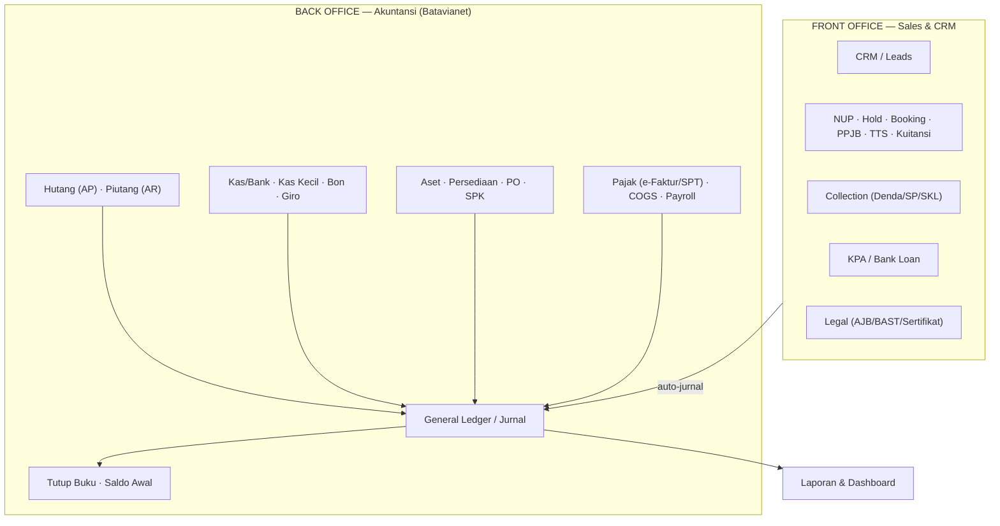
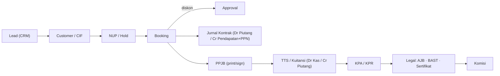
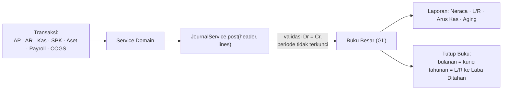
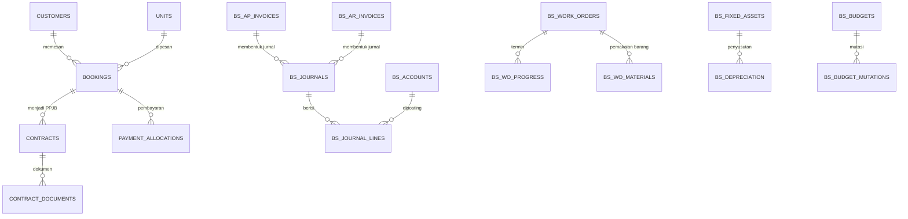
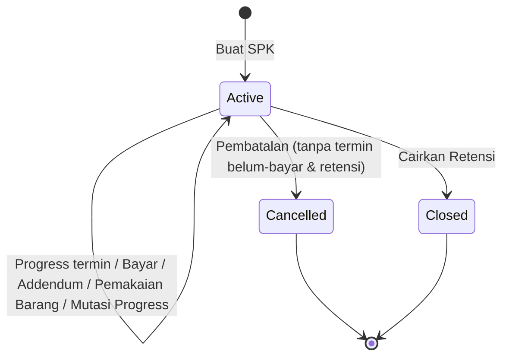
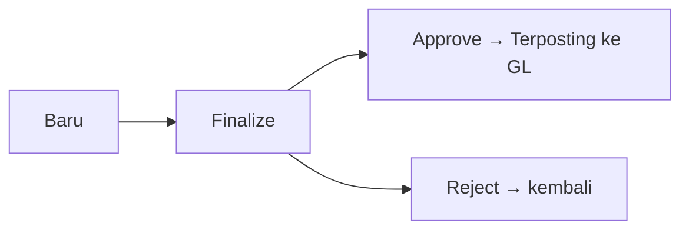

---

## Lampiran D — Diagram

### D.1 Arsitektur Modul (Front Office ↔ Back Office)

### D.2 Alur Penjualan Unit (End-to-End)

### D.3 Alur Posting Akuntansi (Integritas GL)

### D.4 ERD Ringkas (Entitas Inti)

### D.5 Siklus SPK (Kontraktor) — State

### D.6 Lifecycle Persetujuan Jurnal Manual

